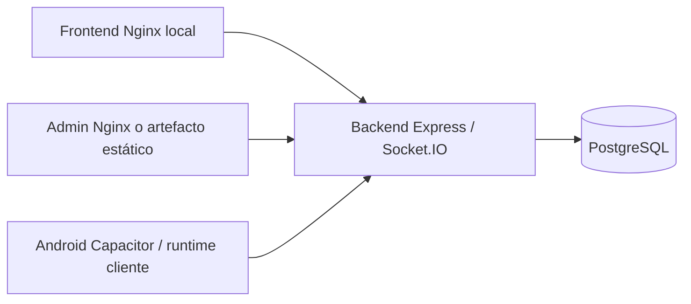

# Arquitectura del código 1.2.0

Revisión documental: 2026-11-05, entrada6399d44; base histórica d3d27d0. Se conserva la arquitectura existente; no hay extracción de módulos ni cambio de tecnología en DOC-01.

El dibujo representa dependencias lógicas, no servicios remotos comprobados. En Compose, ambos Nginx hacen proxy de `/api` y Socket.IO al backend; backend3000 y db5432 son internos. Solo los puertos cliente/Admin se publican al host. Ver [Compose](../compose.yaml) y [desarrollo local](LOCAL-DEVELOPMENT.md).

## Responsabilidades y límites

| Componente | Responsabilidad y fuente |
|---|---|
| Frontend | SPA HTML/JS, recibos, pagos, incidencias y cuenta; [index](../Frontend/index.html) |
| Admin | Consola independiente, usa la misma API con rol admin; [fuentes](../Admin/) |
| Shared | API, UI, estilos, iconos, 2FA, recuperación y timeline compartidos; [fuentes](../Shared/) |
| Backend | Rutas y composición en [server.js](../Backend/server.js); servicios de dominio existentes como [receipt-transactions](../Backend/receipt-transactions.js), pagos, correo, push e incidencias |
| Workers | Correo, recuperación y push con flags y proveedores explícitos; [start.cjs](../Backend/start.cjs) supervisa procesos según configuración |
| Datos | Esquema base y migraciones inmutables; [perfiles](DATABASE.md) |
| Android | Capacitor7 y plugins nativos, sesión protegida por Keystore; runtime generado, no copia de Admin; [guía](ANDROID.md) |

REST usa JSON/JWT y autorización por rol/suministro. Socket.IO comunica cambios; no sustituye la validación de acceso en el servidor. [Contratos de API](API.md). `GET /api/health` comprueba conexión con `SELECT NOW()`; un 200 no demuestra tablas/capacidades completas.

## Contratos de artefacto

[scripts/build-web.js](../scripts/build-web.js) genera cliente web, Admin o staging Android. Frontend Docker conserva lista explícita mínima de siete módulos Shared: api.js, ui.js, styles.css, icons.js, two-factor-ui.js, password-recovery-ui.js e incident-timeline.js, además de assets. [PKG-01](../specs/001-empaquetado-cliente/spec.md) verifica presencia, HTTP/MIME y flujos con fixtures. [Verificador](../scripts/verify-client-runtime.js) rechaza runtime incompleto; build-web y configuración Kubernetes se conservaron.

No todo módulo presente implica capacidad habilitada: recuperación/2FA/push requieren esquema, flags y configuración propios. El cliente Android y el Admin no deben incluir secretos del backend ni archivos privados.

## Perfiles y evolución

Laboratorio con piloto y perfil compatible sin piloto son distintos. DB-01 consulta existencia de la tabla opcional usando la misma conexión transaccional; conserva bloqueos y errores de tablas obligatorias. [Contrato](../specs/002-compatibilidad-recibos/contracts/receipts.md). No hay sincronización automática entre PostgreSQL local y Neon.

Los destinos históricos Android→Render→Neon y Admin→Vercel→Render están descritos en [despliegue](DEPLOYMENT.md). Su configuración activa y todos los disparadores externos siguen pendientes de auditoría completa. [SDD/RPI](SDD-RPI.md) gobierna futuras modificaciones.
