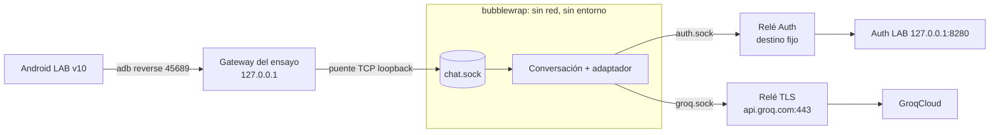

# Ensayo aislado Android LAB → Gateway → conversación → GroqCloud

Lanzador: `scripts/hidrobot-groq/`. Reutiliza `createGateway`, el servicio de conversación y el adaptador GroqCloud sin modificarlos. No cambia la APK, las bases de datos, Docker ni producción.

## Arquitectura



- El servicio corre en un espacio de red vacío: solo tiene un loopback propio. No hereda variables de entorno y ve únicamente el código necesario, en solo lectura.
- Los tres canales son sockets Unix. Cada relé tiene un destino fijo y un tope de bytes. El de Groq tiene además un tope de conexiones igual al presupuesto de peticiones.
- TLS se valida dentro del sandbox contra `api.groq.com`. El anfitrión solo copia bytes cifrados.
- El Gateway escucha únicamente en `127.0.0.1` y solo puede conectarse a los destinos del laboratorio.
- La clave llega por un descriptor de archivo de solo lectura. Nunca pasa por argumentos, entorno, Gateway, Android ni GitHub.

## 1. Ensayo controlado (sin credenciales ni Internet)

```bash
/usr/bin/python3 -I scripts/hidrobot-groq/e2e.py
```

Usa un Auth sintético con dos sesiones, el adaptador real y un transporte de Groq simulado dentro del sandbox. Comprueba, a través del Gateway: 401 sin sesión, 403 con sesión desconocida, texto generado, CORS para el origen de la WebView, aislamiento entre dos sesiones, respaldo por plazo vencido, respaldo por 429 y pausa sin nueva salida. Termina con exactamente tres intentos externos simulados. **No es inferencia real.**

## 2. Ensayo real (requiere autorización expresa)

Condiciones: un administrador de al menos 18 años y elegible, un proyecto aislado de Groq con el modelo permitido, y la revisión de `docs/HIDROBOT-LAB.md` sobre condiciones. Solo cuentas sintéticas en el LAB.

1. Carga una clave **nueva** limitada al proyecto, en terminal local y con el eco desactivado. El lanzador no acepta la clave del piloto anterior, porque usa otro nombre de archivo, y rechaza una clave con más de dos horas.

   ```bash
   (
     set +x; umask 077; set -C
     IFS= read -r -s -p 'Clave de GroqCloud para el ensayo: ' k || exit 1
     printf '\n' >&2
     [ -n "$k" ] || exit 1
     printf '%s\n' "$k" > "/run/user/$(id -u)/hidrobot-groq-e2e.key"
   )
   ```

2. Inicia el ensayo. Repite antes el ensayo controlado y abre el servicio real por 10 minutos con un tope de 6 peticiones.

   ```bash
   /usr/bin/python3 -I scripts/hidrobot-groq/e2e.py --run --ttl 600 --max-external 6
   ```

3. Apunta el teléfono al Gateway del ensayo. Usa el puerto que imprime el lanzador (8285 por defecto). Con ello deja de usarse el Gateway simulado de 8284.

   ```bash
   adb reverse tcp:45689 tcp:8285
   ```

4. En Android LAB v10, inicia sesión con una cuenta sintética y pregunta «¿Cómo ahorrar agua?». La respuesta real lleva el rótulo «Orientación generada» y el enlace oficial. «Generación simulada» indica que no se llegó a Groq. Pide después «¿En pocas palabras?» para ejercitar el contexto.
5. Al terminar, el lanzador imprime el resumen con los intentos externos y los códigos de respaldo. Revoca la clave y retira el archivo. Restablece el puente con `adb reverse tcp:45689 tcp:8284` para volver a la demostración simulada.

Para aprobar: HTTP 200 en el registro `groq`, rótulo «Orientación generada» en el teléfono, texto fiel a los extractos y sin intentos adicionales por encima del tope.

## Límites conocidos

- El Auth del ensayo real es el LAB en `127.0.0.1:8280`. Si no responde, el servicio contesta 503 y Android conserva el catálogo.
- La verificación léxica del texto no detecta toda afirmación plausible pero incorrecta. Revisa cada respuesta real.
- El ensayo no habilita Groq para usuarios finales. Esa decisión sigue pendiente, según `docs/HIDROBOT-LAB.md`.
