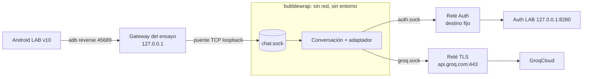

# Ensayo aislado Android LAB → Gateway → conversación → GroqCloud

El lanzador de `scripts/hidrobot-groq/` usa el Gateway, el servicio de conversación y el adaptador GroqCloud del repositorio con la APK LAB ya instalada. El cambio de destino de Android se hace mediante ADB reverse.

## Arquitectura



- El servicio corre en un espacio de red vacío: solo tiene un loopback propio. No hereda variables de entorno y ve únicamente el código necesario, en solo lectura.
- Los tres canales son sockets Unix. Cada relé tiene un destino fijo y un tope de bytes. El de Groq tiene además un tope de conexiones igual al presupuesto de peticiones.
- TLS se valida dentro del sandbox contra `api.groq.com`. El anfitrión solo copia bytes cifrados.
- El Gateway escucha únicamente en `127.0.0.1` y solo puede conectarse a los destinos del laboratorio.
- La clave se monta por descriptor en un archivo de solo lectura del sandbox. El adaptador rechaza una respuesta que la reproduzca. Los registros del relé contienen estado HTTP, latencia y, si están disponibles, totales numéricos de tokens.

## 1. Ensayos sin credenciales ni Internet

Se requieren Python 3, Node, bubblewrap, `ss` y OpenSSL en Debian. Los ensayos USB también usan ADB y `curl` en Android. Las llamadas simuladas tienen `intentos_externos: 0`.

```bash
/usr/bin/python3 -I scripts/hidrobot-groq/e2e.py                  # ensayo controlado
/usr/bin/python3 -I scripts/hidrobot-groq/e2e.py --bridge-check   # puente ADB con el teléfono conectado
/usr/bin/python3 -I scripts/hidrobot-groq/e2e.py --android        # APK instalada + Auth del LAB
```

**Ensayo controlado.** Auth sintético con dos sesiones, el adaptador real y un transporte de Groq simulado. Comprueba desde el anfitrión, sobre procesos vivos, que el servicio corre con red y procesos propios, que solo recibe `PWD` como variable de entorno, que no conserva el descriptor de la clave y que el Gateway solo escucha en `127.0.0.1`. A través del Gateway verifica 401 sin sesión, 403 con sesión desconocida, texto generado, CORS de la WebView, aislamiento entre dos sesiones, respaldo por plazo vencido y por 429, y pausa sin nueva salida. Verifica que ninguna respuesta hacia Android ni registro del sandbox contiene la clave. Termina con exactamente tres intentos simulados.

**Relé TLS local.** El ensayo controlado también pasa por el socket Unix del relé TLS y un servidor HTTPS efímero en loopback. Usa una CA y una clave API ficticias. Un certificado para `api.groq.com` permite una única petición HTTP que solo lleva el tema, estilo, marca de continuación y extractos. Un certificado de la misma prueba con un nombre distinto se rechaza antes de HTTP. El catálogo responde al fallo de TLS y al agotar el presupuesto.

**Ensayo del puente** (`--bridge-check`). Parte del puente en 8284 y arranca 8285 con orígenes sintéticos. Desde `curl` en el teléfono verifica `/ready` 200, `/api/chat` sin sesión 401 y `generated-simulated` para una sesión del doble de Auth. Comprueba el regreso a 8284 y que Auth del LAB rechaza ese token ficticio.

**Ensayo en la APK** (`--android`). Arranca 8285 con los servicios LAB existentes, Auth del LAB y el transporte controlado. Si el puente inicial falta, ejecuta `scripts/hidrobot-groq/adb-bridge.sh rollback`. Después de iniciar el ensayo, ejecuta `scripts/hidrobot-groq/adb-bridge.sh switch` en otra terminal. Usa una cuenta sintética A para verificar su consumo y recibo y preguntar «¿Cómo ahorrar agua?». Cierra su sesión, inicia la cuenta sintética B y confirma que «¿Dime más?» pide contexto. Pregunta «¿Cómo ahorrar agua?» y luego «¿En pocas palabras?». Las dos preguntas iniciales muestran «Generación simulada», y la continuación de B recibe el catálogo con enlace oficial tras el 429 de la tercera solicitud. Cierra la sesión sintética y termina el ensayo con Ctrl-C. `status` debe mostrar 8284 y el puerto de ensayo deja de escuchar.

Para otro equipo, indica `--origins /ruta/a/origins.json` con los cinco orígenes del LAB y, si cambia, `--auth 127.0.0.1:PUERTO`. Con más de un dispositivo, exporta `ANDROID_SERIAL`; `HIDRO_ADB` permite seleccionar el ejecutable del SDK.

## 2. Primer ensayo real: una sola solicitud

Requiere la autorización expresa descrita al final de esta sección. Datos sintéticos únicamente: una cuenta del LAB y la pregunta pública «¿Cómo ahorrar agua?».

Por defecto el lanzador abre **una única petición a GroqCloud** durante 5 minutos (`--max-external 1 --ttl 300`, con máximo 3 peticiones). La cuota se aplica dos veces: el transporte del sandbox rechaza lo que exceda el tope y el relé no abre más conexiones al destino. Si Android envía una pregunta adicional, el servicio responde con el catálogo. El lanzador no reintenta.

1. El administrador carga una clave **nueva**, limitada a un proyecto aislado, en una terminal local con el eco desactivado. El lanzador no acepta la clave del piloto anterior, porque usa otro nombre de archivo, y rechaza una clave con más de dos horas.

   ```bash
   (
     set +x; umask 077; set -C
     IFS= read -r -s -p 'Clave de GroqCloud para el ensayo: ' k || exit 1
     printf '\n' >&2
     [ -n "$k" ] || exit 1
     printf '%s\n' "$k" > "/run/user/$(id -u)/hidrobot-groq-e2e.key"
   )
   ```

2. Inicia el ensayo. Repite antes el ensayo controlado y después abre el servicio real.

   ```bash
   /usr/bin/python3 -I scripts/hidrobot-groq/e2e.py --run --synthetic-supply "$SUMINISTRO_SINTETICO_LAB"
   ```

3. En otra terminal, apunta el teléfono al Gateway del ensayo. El script solo mueve el puente `adb reverse`, no toca la APK y se niega si el Gateway del ensayo no responde.

   ```bash
   scripts/hidrobot-groq/adb-bridge.sh switch
   ```

4. En Android LAB v10 inicia sesión con la cuenta sintética indicada en `--synthetic-supply` y pregunta «¿Cómo ahorrar agua?». La respuesta real aceptada lleva el rótulo «Orientación generada» y el enlace oficial. «Generación simulada» identifica el modo de demostración y un texto del catálogo documenta el respaldo.
5. Al terminar o al vencer el plazo, el lanzador comprueba que la clave no aparece en los registros del sandbox, imprime el resumen y restaura el puente al Gateway anterior.
6. El administrador revoca la clave y retira el archivo `hidrobot-groq-e2e.key`.

Se aprueba con HTTP 200 en el registro `groq`, el rótulo «Orientación generada» en el teléfono, un texto fiel a los extractos, un solo intento externo y la comprobación de ausencia de la clave.

### Cómo comprobar que la respuesta generada aparece en HidroBot

Antes de preguntar, `scripts/hidrobot-groq/adb-bridge.sh status` debe mostrar el puente hacia el puerto del ensayo. Si apunta a 8284, el teléfono habla con la demostración simulada.

| Lo que ves en HidroBot | Qué significa |
| --- | --- |
| Rótulo «Orientación generada» y enlace «Consultar fuente oficial» | La respuesta pasó por GroqCloud y superó la validación del servidor y del cliente |
| Rótulo «Generación simulada» | El puente apunta a la demostración en 8284 o al transporte controlado de `--android` en 8285 |
| Texto sin rótulo | Respaldo del catálogo: el proveedor falló, venció el plazo, hubo cuota o se agotó el tope de una solicitud |

La comprobación se completa con tres evidencias que deben coincidir:

1. **Registro del lanzador.** En modo `run` aparece `{"evento":"groq","http":200,"ms":…,"tokens":{…}}`. Evalúa el texto y la fuente en la pantalla de la APK, porque el registro solo conserva métricas y códigos.
2. **Resumen final.** `intentos_externos` vale 1 y `codigos_backend` está vacío. Un código como `GROQ_AUTH`, `GROQ_QUOTA` o `CHAT_PROVIDER_TIMEOUT` explica un respaldo.
3. **Captura de pantalla.** Opcional. Guárdala solo en `artifacts/`, que git ignora, y solo con la cuenta sintética a la vista:

   ```bash
   adb exec-out screencap -p > artifacts/hidrobot-groq-lab/evidencia-hidrobot.png
   ```

Una segunda pregunta («¿En pocas palabras?») ya no tendrá intento externo disponible y debe mostrar el catálogo sin rótulo. Eso confirma que el tope funciona. No cuenta como fallo.

### Regreso al Gateway anterior

El Gateway de demostración con conversación simulada (puerto 8284) no se detiene durante el ensayo. Para volver, en cualquier momento:

```bash
scripts/hidrobot-groq/adb-bridge.sh rollback
scripts/hidrobot-groq/adb-bridge.sh status
```

`rollback` comprueba la disponibilidad de 8284 antes de mover el puente. Si 8284 se detuvo, primero restablece el Gateway de demostración con `node artifacts/hidrobot-groq-lab/gateway-v2.cjs <origins.json>` en el entorno que lo contiene. `e2e.py` restaura el puente si apunta a 8285 al terminar, al recibir Ctrl-C o SIGTERM, o al fallar el ensayo. Si se desconecta el USB durante el regreso, vuelve a conectarlo y ejecuta `rollback`.

### Pasos reservados al operador autorizado

Solo estos pasos requieren a la persona elegible o el teléfono en sus manos. El resto se ejecutó y verificó localmente.

| Paso | Quién |
| --- | --- |
| Confirmar la elegibilidad (18 años, proyecto aislado, modelo permitido) y autorizar expresamente **una** inferencia real con datos sintéticos | Administrador de GroqCloud |
| Cargar la clave nueva con el comando del paso 1 | Administrador, en terminal local |
| Ejecutar `e2e.py --run` y `adb-bridge.sh switch` | Operador |
| Iniciar sesión con la cuenta sintética y preguntar «¿Cómo ahorrar agua?» en el POCO M4 Pro | Operador |
| Revocar la clave y retirar `hidrobot-groq-e2e.key` | Administrador |
| Revocar y retirar la clave del piloto anterior, `hidrobot-groq-pilot.key`, que este lanzador no usa | Administrador |

### Autorización necesaria

Solo una: **el administrador elegible de GroqCloud (mayor de 18 años, de un proyecto aislado con `openai/gpt-oss-20b` permitido) autoriza expresamente una única inferencia real con datos sintéticos y carga una clave nueva** de ese proyecto. No se habilita facturación ni acceso para usuarios finales.

## Límites conocidos

- El Auth del ensayo real es el LAB en `127.0.0.1:8280`. Si no responde, el servicio contesta 503 y Android conserva el catálogo.
- La verificación léxica del texto no detecta toda afirmación plausible pero incorrecta. Revisa cada respuesta real.
- El ensayo no habilita Groq para usuarios finales. Esa decisión sigue pendiente, según `docs/HIDROBOT-LAB.md`.
