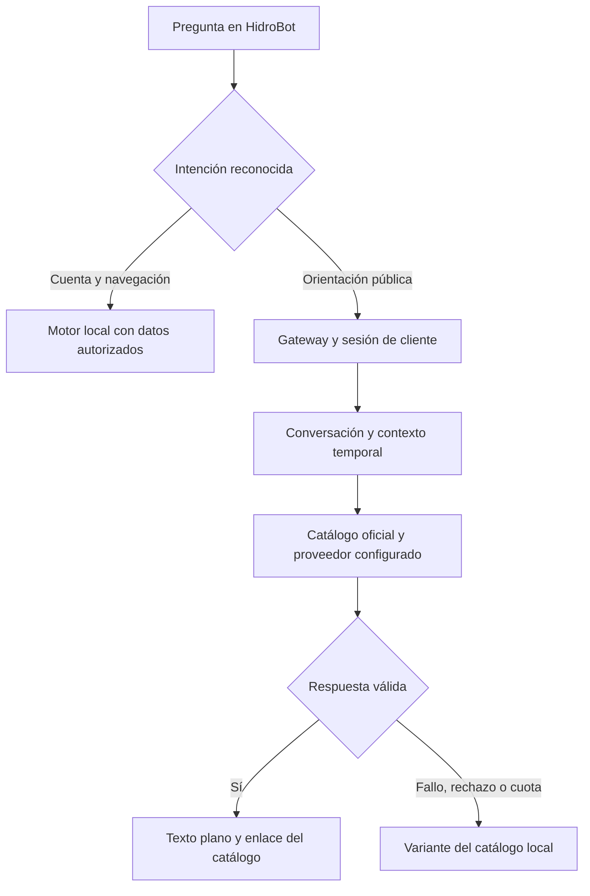

# HidroBot 3.0 en el laboratorio

Las consultas de recibos, pagos, vencimientos, consumos, incidencias y cortes del suministro se resuelven con los datos de la sesión en Android o web. El motor local conserva la navegación, el historial del recibo y las aclaraciones. Si la información de la cuenta está desactualizada o falta conexión, la aplicación indica que no pudo verificarla.



## Contrato de conversación

`POST /api/chat` requiere una sesión activa de rol cliente. La versión 1, que utiliza Android LAB v9, conserva el selector de variantes. La versión 2 exige el campo `style`, que toma el valor `standard` cuando el usuario no indica un estilo.

```json
{"version":2,"conversationId":"6c287f16-c231-4122-be7d-5449ff72cc09","topic":"saving","style":"standard"}
```

El cliente clasifica consultas de cuenta, orientación pública o aclaración. Solo la orientación pública se normaliza a un código del catálogo. Admite los estilos `standard`, `detail`, `simple` y `summary`. Usa `more` para continuar un tema conocido y puede volver a enviar el código público después de recuperar la conexión. Un seguimiento sin contexto solicita aclaración. El servidor separa el contexto por huella de sesión e identificador de conversación, guarda hasta cuatro referencias durante cinco minutos y conserva como máximo mil conversaciones en memoria.

La respuesta v2 lleva `version`, `mode` y, cuando corresponde, `topic`. Los modos `generated` y `generated-simulated` incluyen `text` y `evidence`. Los modos `simulated` y `fallback` incluyen `variant`. Para referencias válidas, el cliente añade la URL que ya conoce del catálogo. Los estados 400, 401, 403, 413, 429 y 503 distinguen entrada inválida, falta de acceso, tamaño, cuota e indisponibilidad. Cada respuesta usa `Cache-Control: no-store`.

## Proveedores

| Valor de `CHAT_PROVIDER` | Comportamiento |
| --- | --- |
| `local` | Valor predeterminado. Responde con las variantes del catálogo. |
| `simulated-generation` | Ejercita el contrato de texto con un proveedor determinista, solo para pruebas y demostración LAB. La interfaz marca el texto como «Generación simulada». |
| `groq` | Habilita GroqCloud explícitamente. Requiere `CHAT_GROQ_API_KEY` solo en el backend. Si la clave falta o el modelo es inadmisible, el servicio arranca con el catálogo y registra un código de configuración. |

El adaptador usa `openai/gpt-oss-20b` por defecto. `CHAT_GROQ_MODEL` admite también `openai/gpt-oss-120b`, que comparte el soporte de esquemas estrictos. Envía solo el tema, el estilo, si es una continuación y las oraciones del catálogo compatibles con los filtros de salida. El destino fijo es `POST https://api.groq.com/openai/v1/chat/completions`, con autorización Bearer, `max_completion_tokens: 512`, razonamiento bajo y JSON Schema estricto. El servidor lee `choices[0].message.content` de una respuesta completa. No se habilitan herramientas, búsqueda, redirecciones ni transmisión de razonamiento. El transporte se puede simular en las pruebas. [Modelos](https://console.groq.com/docs/models) · [Referencia de API](https://console.groq.com/docs/api-reference) · [JSON Schema estricto](https://console.groq.com/docs/structured-outputs)

El servicio acepta hasta doce solicitudes por minuto y sesión, sesenta por IP y cuerpos de hasta un KiB. Permite ocho operaciones simultáneas, con un plazo del proveedor de seis segundos en el arranque normal. Cancela el transporte cuando vence el plazo o se desconecta el cliente. El adaptador limita la respuesta a dieciséis KiB y el texto visible a 640 caracteres, o a 280 para un resumen. Los fallos de red, cuota, permisos y contenido inválido activan el catálogo sin reintentos automáticos. Ante HTTP 429, el adaptador aplica una pausa compartida en el proceso según `Retry-After` en segundos, acotada entre uno y sesenta segundos. Si el encabezado falta, aplica diez segundos. Los registros de fallos contienen solo códigos acotados y limitados en frecuencia.

## Privacidad y seguridad

El cliente conserva el mensaje original. El Gateway y el servicio de conversación reciben solo la consulta normalizada y el identificador de conversación. El JWT se usa para consultar Auth y nunca se pasa al proveedor. La solicitud al proveedor tampoco incluye correo, DNI, contraseña, OTP, dirección, suministro, historial privado, datos bancarios, ni recibos o importes. El proveedor no tiene herramientas ni acceso a la base de datos. El texto recibido se comprueba en el servidor y en el cliente, y se renderiza con `textContent`.

Los extractos y sus referencias provienen del catálogo local. Sus fuentes incluyen las guías oficiales de [lectura de recibos](https://www.gob.pe/institucion/vivienda/noticias/1183077-cuidemos-el-agua-sedapal-te-ensena-a-leer-el-consumo-de-agua-potable-en-tu-recibo), [ahorro](https://www.gob.pe/institucion/sedapal/noticias/1178111-sedapal-te-guia-hacia-un-consumo-responsable-y-sostenible-del-agua) y [consulta de cortes](https://www.gob.pe/35074-consultar-zonas-con-interrupciones-de-servicio-de-agua-actuales-en-lima-y-callao). El filtro exige referencias del tema y coincidencia con términos de los extractos. Rechaza cifras, enlaces, marcado, solicitudes de datos privados y expresiones que atribuyen importes, vencimientos o estados a una cuenta. El adaptador también filtra tarifas, cantidades escritas, fechas específicas y estados de incidencias en la salida del proveedor. La comprobación léxica tiene alcance limitado para detectar afirmaciones plausibles pero incorrectas. Evaluar la fidelidad de las respuestas reales antes de cualquier activación.

## Laboratorio y reversión

Usa exclusivamente un Gateway de LAB y cuentas sintéticas. El cliente y el destino de conversación vienen desactivados en el build y Compose base. Para comprobar el perfil de laboratorio:

```sh
HM_CHAT_LAB=1 API_BASE_URL= node scripts/build-web.js web
CHAT_PROVIDER=simulated-generation docker compose --env-file .env.services \
  -f compose.services.yaml -f compose.conversation.yaml config --services
```

El build web queda en `artifacts/web/client`. En un LAB autorizado para aplicar su configuración, sirve ese build y levanta la extensión de conversación y el Gateway con los mismos archivos Compose. El proxy de la APK LAB usa `http://127.0.0.1:45689`. Configura ADB reverse hacia el puerto del Gateway del LAB en el que esté habilitado v2. La red interna de Compose no tiene salida de Internet. Conserva ese aislamiento durante pruebas simuladas.

El lanzador aislado y su procedimiento están en `docs/HIDROBOT-GROQ-E2E.md`. El código puede integrarse con `CHAT_PROVIDER=local` como valor predeterminado. Los flujos de producción siguen usando el catálogo sin depender de la clave temporal ni del Gateway de ensayo. La inferencia real desde Android queda pendiente de una autorización expresa y una clave nueva gestionada por un operador elegible. En ese ensayo se usan una cuenta sintética, una instancia aislada y HTTPS restringido a `api.groq.com`. La interfaz marca respuestas aceptadas como «Orientación generada». Para revertir, restablece `CHAT_PROVIDER=local` y retira la clave y la salida a GroqCloud. También puedes retirar el destino de conversación del Gateway para usar solo el motor del cliente. El cambio no requiere migración ni una APK nueva si Android LAB v10 ya está instalada.

`npm test` valida el motor, el cliente y los contratos con Node 22. `npm run test:integration` usa un PostgreSQL 18 sintético aislado con las variables descritas en `scripts/test-runner.cjs`. La validación de Chromium usa el Gateway LAB, dos cuentas sintéticas y respuestas que imitan el contrato HTTP de GroqCloud. Cubre el indicador, texto largo, turnos, HTML rechazado, cuota agotada, recuperación tras perder la conexión e incidencias. La instalación de una candidata LAB y la verificación en un teléfono requieren autorización separada.

La validación de esta integración completó 194 pruebas unitarias y de contratos. PostgreSQL 18 registró 92 aprobadas y una omisión de la prueba histórica de recibos duplicados. En el POCO M4 Pro, la APK LAB v10 instalada pasó el recorrido de sesión, recibos, consumos, orientación simulada, contexto, navegación y reconexión con este Gateway. La inferencia real queda pendiente de un piloto autorizado.

## Cuotas y condiciones de activación

- La página de cuotas, consultada el 2026-11-18, muestra para GPT-OSS 20B **30 solicitudes por minuto, 1.000 por día, 8.000 tokens por minuto y 200.000 por día** y los presenta como límites base del plan Developer. La fila no indica el nivel gratuito, y la tabla de modelos publica otra cifra de tokens por minuto. Consulta los límites de la organización en la consola y los encabezados de respuesta antes de activarlo. [Cuotas y encabezados](https://console.groq.com/docs/rate-limits)
- Groq exige 18 años para el acceso o uso directo de sus servicios. El acuerdo contempla integraciones para usuarios finales y atribuye al cliente la responsabilidad de cumplir las leyes aplicables cuando su aplicación se dirige a menores o es probable que accedan. Antes de activar la inferencia para el público previsto, confirma la elegibilidad, la política de uso y los avisos o consentimientos aplicables. Mientras esté pendiente esa revisión, usa el catálogo o el simulador en la feria. [Acuerdo de Groq](https://console.groq.com/docs/legal/services-agreement)
- Groq indica que la inferencia no se retiene por defecto y que puede registrar temporalmente entradas y salidas para atender incidentes de fiabilidad o abuso. Revisa los controles de datos de la organización. Envía únicamente temas públicos y extractos autorizados, incluso si la organización dispone de retención cero. [Tratamiento de datos](https://console.groq.com/docs/your-data)

## Verificación de condiciones de Groq — 2026-11-18

Lectura de las páginas públicas de Groq, sin ninguna llamada a la API:

- El acuerdo de servicios (modificado el 22 de junio de 2026) exige 18 años y describe el servicio como no destinado al consumidor. La sección 6.3 hace al cliente responsable del cumplimiento legal cuando su aplicación se dirige a menores o es probable que accedan. La 6.2 exige los consentimientos y avisos necesarios, y la 4.3 desaconseja usar las salidas como asesoría médica, legal, financiera o profesional. No se encontró una restricción por país ni una regla específica para chatbots, pero la lectura de las secciones posteriores a la 7 no fue literal.
- La política de IA prohíbe actividades engañosas y desinformación, exige evaluar la exactitud de las salidas y limita las decisiones automatizadas de alto riesgo sin supervisión humana. No exige avisar de que el usuario habla con IA. HidroBot lo hace de todos modos con el rótulo «Orientación generada».
- Tratamiento de datos: por defecto no se retienen las entradas de inferencia. Pueden registrarse hasta 30 días solo para fallos de fiabilidad o abuso. La retención cero requiere elegibilidad y se almacena en Estados Unidos.
- Modelo: `openai/gpt-oss-20b` figura como modelo de producción y con modo estricto de JSON Schema.

Conclusión: el piloto de un administrador adulto sigue siendo la única activación respaldada. La exposición a usuarios finales, entre ellos menores, requiere la decisión del titular de la cuenta sobre los avisos, consentimientos y la jurisdicción. Hasta entonces, la feria usa el catálogo o el simulador.

## Recorrido corto para la feria

1. Conecta la APK LAB v10 al Gateway v2 del laboratorio y confirma que esté configurado como `simulated-generation`.
2. Inicia sesión con una cuenta sintética. Consulta su último consumo y abre el detalle de un recibo. El dato se obtiene de la cuenta LAB.
3. Pregunta «¿Cómo ahorrar agua?» y luego «¿En pocas palabras?». Muestra el enlace oficial y explica que el rótulo «Generación simulada» identifica el modo de demostración.
4. Abre Incidencias y Cortes desde su navegación. Si falla el transporte de conversación, vuelve al chat y muestra cómo el catálogo sigue respondiendo.
