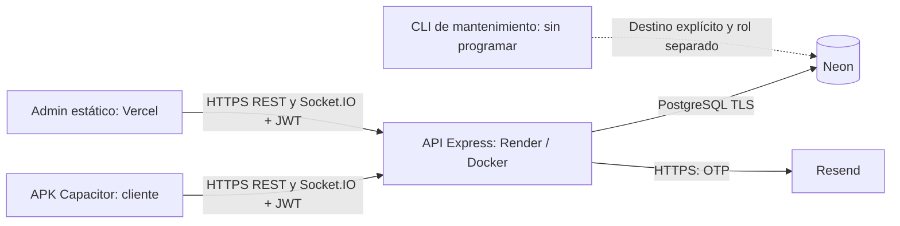

# Auditoría de preparación para producción — avance 12

**Proyecto:** Hidro-Mejora · **Repositorio:** NicolasAG-pe/Sedapal.

**Fecha:** 18 de octubre de 2026, America/Lima.

**Código auditado:** `b8e2d62059c7ac06b4c48c28dd9ca81e6fc47d4f`, rama `feature/verificacion-correo`.

**Referencia anterior:** tag `v1.0.0`, commit `135cb54173ee60e2f528738805564773e3c32e8b`.

**Revisión:** [Draft PR #1](https://github.com/NicolasAG-pe/Sedapal/pull/1), hacia `main`.

**Seguimiento posterior — avance 13:** [H02 corregido en desarrollo](integridad-recibos.md),
con transacciones coordinadas, pruebas concurrentes y migración 005 preparada.
Su aplicación productiva sigue pendiente. Los hallazgos, cifras y evidencias
originales siguientes describen el código auditado del avance 12; no se reescribe
esa evidencia histórica ni se declara la versión lista para publicar.

**Seguimiento posterior — avance 14:** [H03 corregido en desarrollo mediante
Transactional Outbox](correo-outbox.md). Solicitud y evento cifrado se confirman
juntos; el trabajador independiente opera después del commit, con recuperación,
leases, idempotencia estable y reintentos limitados. Se reprodujo el defecto antes
de cambiarlo y se validó la corrección en PostgreSQL aislado y Node 20/22, con
proveedor simulado. La migración 006 y la habilitación productiva siguen pendientes;
H01 (APK v1.0.0), dominio/remitente y los demás riesgos no se dan por resueltos.
El informe original conserva su evidencia y numeración históricas.

**Seguimiento posterior — avance 15:** [H01 mitigado en desarrollo](android-transicion.md):
cliente antiguo recibe actualización requerida antes de crear solicitudes; login
se conserva, rutas OTP separadas y UUID idempotente recuperan respuestas perdidas.
Probado con HTML v1.0.0 y perfiles Chromium contra PostgreSQL aislado. La APK
instalada no se actualiza remotamente: firma, instalación sobre v1.0.0, validación
Android nativa/física y publicación coordinada siguen pendientes. La evidencia
original siguiente no se reescribe ni se declara producción lista.

**Seguimiento posterior — avance 16:** [APK candidata compilada y validación
nativa en Android 15](pruebas/android-1.1.0-nativo.md). Firma permanente y
actualización 1.0.0/2 → 1.1.0/3 comprobadas sin desinstalar, conservando preferencias.
Flujos de escritura con debug/API/base aisladas y Resend simulado. La validación
física, requisitos productivos y distribución siguen pendientes; sin despliegues.

## 1. Resumen ejecutivo y dictamen

**La nueva versión no está lista para publicarse en producción.** El flujo OTP tiene controles adecuados y sus regresiones locales pasan, pero la transición Android rompe el registro de la APK anterior. Además, se reprodujeron carreras de integridad de recibos/pagos y un fallo de consistencia entre envío de correo y commit PostgreSQL. Se necesita corregir y validar estos puntos antes de autorizar una publicación.

Se registran **7 hallazgos de gravedad alta, 9 media y 2 baja**. No se acreditó una vulnerabilidad crítica durante esta revisión; eso no demuestra su inexistencia. Algunos hallazgos son defectos reproducidos; otros son riesgos de diseño o requisitos operativos aún sin acreditar. La gravedad considera una futura aplicación pública con datos de usuarios; el uso académico no equivale a capacidad para operar un servicio oficial de agua ni procesar pagos bancarios.

Este avance cambia únicamente documentación. No corrige automáticamente lógica de negocio, compatibilidad ni configuración productiva. No ejecuta migraciones en Neon, envíos reales, limpiezas de bases existentes, builds de APK, despliegues, programación, cambios remotos de configuración ni merge.

## 2. Alcance y calidad de la evidencia

| Etiqueta | Significado |
| --- | --- |
| **P** | Comprobado ahora mediante ejecución local con fixtures sintéticos. |
| **E** | Revisado estáticamente en el código/configuración del commit indicado. |
| **R** | Consultado mediante una API remota de solo lectura; no acredita pruebas funcionales productivas. |
| **H** | Evidencia histórica versionada; no repetida en esta auditoría. |
| **N** | No verificado en el destino real; pendiente de autorización/acceso o de trabajo futuro. |

Componentes: servidor Express, JWT/roles/propiedad, registro OTP, adaptador HTTP Resend, configuración PostgreSQL, esquema y migraciones 003/004, retención y CLI, clientes/gestión de sesiones, Capacitor/Android/firma, Docker/Compose/Nginx, archivos Vercel y procedimientos Render/Neon, respaldos y recuperación. Se revisaron también scripts de generación de runtimes, pruebas y documentación operativa.

Las pruebas usan Node **20.19.2** y PostgreSQL **18** en el contenedor aislado de correo, publicado solo en loopback. Cada integración crea y conserva una base nueva; no utiliza `.env` ni conexiones Neon. Docker declara Node `22-alpine`: **no se ha repetido toda la batería dentro de la imagen productiva Node 22**. No se realizó pentest externo, carga sostenida, auditoría de todo el historial Git, inspección de un nuevo binario APK, prueba física del nuevo flujo ni restauración productiva. Las comprobaciones de integridad usan datos sintéticos y no certifican el estado actual de Neon.

## 3. Arquitectura actual

En desarrollo, dos Nginx sirven cliente y Admin y hacen proxy al backend por la red Compose. PostgreSQL y backend no publican puertos al host en el Compose principal. La arquitectura publicada documentada distribuye cliente por APK, Admin por Vercel y API por Render; no existe un sitio web de clientes publicado acreditado. El esquema SQL es la fuente de verdad de negocio; los sockets solo avisan y las interfaces reconsultan REST. Las salas y limitadores IP viven en memoria: el diseño actual requiere una instancia.

El registro nuevo devuelve `202` con solicitud pendiente; el OTP confirmado devuelve `201` y crea usuario y suministro en una transacción. El login posterior devuelve JWT. Las cuentas previas no se marcan artificialmente como verificadas. Fuentes: [API](API.md), [despliegue](DEPLOYMENT.md), [servidor](../Backend/server.js) y [registro](../Backend/email-registration.js).

## 4. Hallazgos por criticidad

### Crítica

No hay hallazgos críticos demostrados con el alcance disponible. No se atribuye ausencia de secretos a todo el historial ni seguridad absoluta a la infraestructura remota.

### Alta

| ID / evidencia | Hallazgo y efecto | Acción necesaria / condición de cierre |
| --- | --- | --- |
| **H01 · P/E** | **Registro incompatible entre APK/backend.** v1.0.0 exige `data.estado === 'ok'`; recibe `202/pendiente`, muestra la respuesta en su área de error y carece de pantalla OTP. Repetir no crea una cuenta utilizable. El cliente actual tampoco acepta el `201/ok` del backend anterior. | Implementar y probar la transición de la sección 7 antes de distribuir. Mantener el login de cuentas previas y un mensaje de actualización legible por la APK antigua. |
| **H02 · P/E** | **Carreras en recibos administrativos.** Dos `POST` concurrentes pasan el `SELECT` de duplicados y crean dos recibos iguales (`201/201`). Anular consulta ausencia de pagos fuera de una transacción; un pago intermedio confirmado permite después `200` y estado `Anulado` con un pago existente. Editar monto/periodo tiene el mismo patrón de comprobar y actualizar por separado, aún no reproducido para edición. | Bloquear el recibo dentro de una transacción común con pagos, revalidar y actualizar atómicamente. Añadir unicidad de suministro/periodo tras diagnosticar duplicados y acordar su tratamiento; no borrar ni fusionar históricos automáticamente. |
| **H03 · P/E** | **Correo y PostgreSQL no son atómicos.** Se envía antes del commit. Un envío aceptado seguido de fallo antes de confirmar deja correo sin solicitud persistida. Reintentar genera otro UUID de envío y otra clave de idempotencia; el historial/cuota solo registra el último envío confirmado. También existe ambigüedad si se pierde la respuesta del commit o del proveedor. | Diseñar evento/outbox persistente e idempotencia duradera por operación. Separar aceptación, envío y confirmación con estados recuperables; tratar el OTP como secreto si debe persistirse cifrado para reintentar. Probar caídas en cada frontera, reenvío y respuesta perdida. |
| **H04 · E** | **Disponibilidad compartida con registro público.** Registro/reenvío conserva una conexión y advisory/row locks mientras Resend puede tardar hasta aproximadamente 21 s (dos timeouts de 10 s y pausa). Otras solicitudes pueden esperar indefinidamente por pool/locks porque la API no fija tiempos de conexión/SQL. `scryptSync` bloquea el event loop. No hay handler `pool.on('error')` ni cierre ordenado SIGTERM en el servidor. | Sacar la red externa de la transacción, acotar esperas, tratar errores ociosos y drenar HTTP/sockets/pool al terminar. Evaluar scrypt asíncrono con concurrencia acotada y pruebas de carga/fallo; medir presupuesto de conexiones real. |
| **H05 · E; condicional** | **Verificar correo no verifica titularidad del suministro.** El registro admite cualquier número libre de nueve dígitos. No consulta un padrón autorizado, invitación ni prueba de vinculación. | Bloqueante si se quiere pasar del prototipo a usuarios/suministros oficiales: definir validación de titularidad y política de reclamación. Si se conserva alcance académico, explicitarlo y aislar sus datos; no presentarlo como servicio oficial. |
| **H06 · E/H/N** | **Remitente y configuración productiva de correo pendientes de acreditación.** La prueba real histórica no demuestra dominio propio, DNS ni capacidad de enviar a todos los usuarios. Sin configuración válida el registro responde 503; un remitente de prueba puede provocar rechazo general para terceros. | Dominio propio verificado, `RESEND_FROM` de ese dominio, API key de envío con alcance mínimo y secreto OTP exclusivo. Acreditar configuración por canal privado y ensayos autorizados antes de habilitar altas. |
| **H07 · E/N** | **Operación productiva sin evidencia suficiente.** No se han comprobado roles/ACL reales de Neon, restauración reciente, ventana de recuperación, capacidad, alertas ni parámetros completos de auto-deploy Render. La existencia de guías y health 200 no cubre estos requisitos. | Completar inventario de solo lectura autorizado y ensayo de restauración en destino nuevo; fijar responsables, RPO/RTO, roles mínimos y alarmas. Revisar automatizaciones antes de publicar cualquier commit que pudiera desplegar. |

**Evidencia precisa:** H01: `git show v1.0.0:Frontend/index.html`, líneas 4922–4946; cliente actual `Frontend/index.html:5038–5055`; contrato `Backend/email-registration.js:154–168`. H02: `Backend/server.js:1873–2119`, frente a pago transaccional `994–1148`; `init.sql` no define unicidad de `(id_suministro, periodo)`. H03: `email-registration.js:19–31,62–73` y `resend-mail.js:19–59`. H04: `server.js:94,430–455,2851–2861` y `email-registration.js:35–38`. H05: `server.js:659–663` y `email-registration.js:90–105`. H06: `resend-mail.js:5–17` y [prueba histórica](pruebas/2026-10-18-resend-otp.md). H07: [mantenimiento](MAINTENANCE.md) y límites remotos de la sección 8.

Los diagnósticos H02 usan barreras en el adaptador SQL del proceso de prueba para forzar intercalaciones válidas; no alteran los handlers ni afirman una frecuencia de ocurrencia real. H03 inyecta un error **antes** del commit después de que el proveedor simulado acepte; no simula una transacción distribuida ni prueba entrega real. Son reproducciones de defectos esperados: su diagnóstico aprobado no significa que el producto esté corregido.

### Media

| ID / evidencia | Hallazgo | Recomendación |
| --- | --- | --- |
| **M01 · P/E** | Migraciones sin `lock_timeout`/`statement_timeout` ni comprobación de estructura existente. `IF NOT EXISTS` evita repetir nombres, pero no reconcilia columnas, FKs o índices incorrectos. 003 requiere bloqueo de `usuarios`; 004 crea índice normal que puede bloquear escrituras. | Aplicación manual con ventana, timeouts, inventario y validación posterior. Para tablas grandes, evaluar variante concurrente separada y revisada, nunca insertar `CONCURRENTLY` dentro del `BEGIN` actual. |
| **M02 · E/H/P parcial** | JWT de 8 h sin revocación central tras logout/cambio de clave. Socket verifica expiración y rol al conectar, sin caducidad activa posterior. Secreto JWT solo se exige no vacío; no hay política de entropía ni `issuer/audience/algorithms` explícitos. Health puede funcionar sin secretos de auth/correo. | Validación de configuración al inicio/readiness específica; secreto aleatorio robusto; política de revocación/versionado de sesión y expiración del socket. Fijar algoritmos/emisor/audiencia con transición de tokens compatible. No se detectó un bypass por algoritmo. |
| **M03 · E** | Muchos handlers imprimen objetos de error SQL; pueden incluir datos personales en `detail`. No hay middleware uniforme JSON para parser, 404 y errores. Cabeceras `no-store` explícitas solo se fijan en rutas OTP después del limiter. | Logging estructurado con redacción y correlación; errores públicos estables sin SQL; cache explícita para auth/datos privados, incluidos fallos y 429. No registrar cuerpos de login/OTP. |
| **M04 · E/P parcial** | Límites IP solo en memoria, reiniciables y por instancia. Login no limita por cuenta; IPs distribuidas pueden concentrar intentos. `trust proxy=1` presupone una cadena concreta. Registro distingue conflicto/pendiente, permitiendo inferencias sobre cuentas y suministros. | Validar proxy en Render, pruebas de spoofing en entorno autorizado, límites compartidos y por identidad con protección contra bloqueo abusivo; revisar respuestas y tiempos para reducir enumeración. Los límites persistentes OTP sí están probados. |
| **M05 · E/P parcial** | Peticiones cliente sin timeout general ni recuperación de resultado desconocido. Si verificar confirma y se pierde la respuesta, el siguiente intento devuelve 400 aunque la cuenta ya exista. `Shared/api.js` cierra sesión ante cualquier 403/401, incluso errores de una operación concreta. | Timeouts y mensajes accionables, recuperación hacia login sin repetir escrituras ciegamente, y códigos de error que distingan sesión de permiso/credencial actual. Probar suspensión/reanudación, red intermitente y respuesta perdida en teléfono. |
| **M06 · P/E** | CORS no expone `Retry-After`; WebView/Admin entre orígenes no pueden leerlo aunque exista. El cliente usa fallback 60 s para un límite que puede durar 3600 s. | Exponer solo cabeceras necesarias y probar cooldown entre orígenes. Incluir exactamente los orígenes productivos; no usar comodines. |
| **M07 · E/N** | `usuarios.correo` tiene UNIQUE sensible a mayúsculas, pero la API consulta `lower(correo)` sin índice equivalente. No hay FK única de suministro por usuario, aunque auth usa `LIMIT 1`. SQL de API/migración usa nombres sin esquema explícito. Faltan garantías de negocio adicionales y planes de ejecución bajo volumen. | Inventariar datos antes de normalizar/unificar; decidir cardinalidad y restricciones. Rol sin CREATE en esquemas buscados; fijar esquema. Medir `EXPLAIN` con fixtures representativos antes de añadir índices, incluido historial por fecha/identidad. |
| **M08 · E** | Imágenes con tags mutables, backend con usuario root predeterminado, sin límites explícitos de recursos. Nginx local sirve HTTP y no define CSP para estáticos; Helmet API no protege esos HTML. Manifiesto Android permite backup y FileProvider declara rutas amplias. La imagen backend no incluye CLI/núcleo de limpieza ni paquete raíz. | Fijar imágenes y runtime validados, usuario no privilegiado y límites; TLS externo para VPS y cabeceras de estáticos tras inventariar scripts inline. Restringir backup/rutas Android según necesidad. Diseñar artefacto de mantenimiento separado antes de programarlo. |
| **M09 · E/N** | No hay métricas de cola/pool/locks/OTP ni eventos de entrega/rebote integrados. Resend reintenta 429/5xx/red con pausa fija de 1 s sin `Retry-After` ni jitter. Aceptación HTTP no acredita entrega. | Métricas sin correo/OTP, alertas y reconciliación; respetar cuota y backoff con límite. Evaluar webhooks autenticados/idempotentes con retención limitada; no son requisito para aceptar un código, pero sí ayudan a operar fallos. |

Fuentes locales: [configuración](../Backend/config.js), [servidor](../Backend/server.js), [API cliente](../Shared/api.js), [sesión cliente](../Frontend/assets/js/client-session.js), [Compose](../compose.yaml), [Dockerfile](../Backend/Dockerfile), [Nginx](../Frontend/nginx/default.conf), [manifiesto](../android/app/src/main/AndroidManifest.xml), [FileProvider](../android/app/src/main/res/xml/file_paths.xml). M01 incluye un bloqueo real controlado; M06 incluye inspección de cabeceras HTTP, sin atribuirle una nueva prueba física WebView.

### Baja

| ID / evidencia | Hallazgo | Recomendación |
| --- | --- | --- |
| **B01 · E** | `authRequests` conserva cada AbortController de peticiones exitosas hasta limpiar sesión; solo lo elimina en `catch`. | Liberar al terminar de consumir/cancelar la respuesta, sin perder protección frente a logout durante lectura del body. |
| **B02 · E** | Documentación operativa principal describe v1.0.0; nombres de comandos y cobertura pueden confundirse con resultados de la rama. `test:email` reporta archivos, no todos los casos internos individualmente. | Actualizar guías junto al siguiente cambio funcional y mantener evidencia por commit; no sumar archivos, grupos y comprobaciones como si fueran una métrica homogénea. |

## 5. Backend y Resend: controles que sí se comprobaron

- **P/E:** OTP de seis dígitos con `crypto.randomInt`, HMAC-SHA256 ligado al UUID y secreto exclusivo; comparación de tiempo constante. No se guarda OTP en claro en las tablas. Secreto de al menos 32 bytes y distinto del JWT; longitud no garantiza aleatoriedad.
- **P/E:** código vigente **300 s**, solicitud **1 h**, cinco intentos acumulados por solicitud, 60 s entre envíos, tres envíos/hora por correo y suministro. Reenvío cambia OTP sin reiniciar intentos. Reiniciar registro crea otra solicitud: los cinco intentos no constituyen un límite vitalicio por identidad; la cuota horaria sigue aplicando mediante historial.
- **P:** no hay usuario, suministro ni JWT antes de confirmar; confirmación concurrente consume una vez; conflicto no deja huérfanos; códigos incorrectos/vencidos y solicitudes sustituidas se rechazan. UUID impredecible reduce adivinación, pero no sustituye el control de intentos.
- **P/E:** contraseña scrypt con salt aleatorio, consultas parametrizadas, rol no elegible en registro; `requiereAuth` reconstruye rol/activo/propiedad desde PostgreSQL. Las **19 rutas admin** rechazan usuario normal y ausencia de JWT. Tokens expirados o alterados se rechazan. No se observó SQL arbitrario controlable en los fragmentos dinámicos revisados.
- **P/E:** cuenta previa sintética con `correo_verificado_en=NULL` conserva login. Es una excepción deliberada para compatibilidad: la obligatoriedad se aplica a nuevas altas de esta API, no a todos los usuarios persistidos. Un escritor antiguo/externo con INSERT aún podría crear usuarios sin verificación; debe retirarse antes del corte.
- **P/E:** Resend solo desde backend por HTTPS, sin seguir redirecciones, dos intentos máximos, timeout por intento, cuerpo/clave iguales en el reintento interno. Errores permanentes no se reintentan; mensajes de proveedor no se propagan. El ID devuelto por proveedor no se persiste para reconciliar. La protección de idempotencia actual termina al reiniciar la operación, como demuestra H03.

Variables privadas: `RESEND_API_KEY`, `RESEND_FROM`, `EMAIL_OTP_SECRET` y `AUTH_TOKEN_SECRET` son del backend. Nunca deben incorporarse a `hm-api-config.js`, Vercel estático o runtime Android. Los archivos privados y artefactos están ignorados, pero `.gitignore` no sustituye revisar el índice Git ni protege secretos ya publicados. No se leyeron ni copiaron valores privados a este informe.

`onboarding@resend.dev` es un remitente de pruebas restringido a la dirección de la cuenta Resend; no habilita registro público de terceros. Exigir dominio propio verificado y autenticación DNS; definir DMARC según la política del dominio. No se afirma que el dominio productivo ya exista o esté verificado. Véanse [restricción oficial](https://resend.com/docs/knowledge-base/403-error-resend-dev-domain) y [dominios](https://resend.com/docs/dashboard/domains/introduction).

La clave `verificacion-correo/<UUID>` cabe en el contrato Resend; la retención del proveedor para idempotencia es 24 h. Eso deduplica reintentos de la misma clave, **no coordina el commit local**. [Contrato de envío](https://resend.com/docs/api-reference/emails/send-email) e [idempotencia](https://resend.com/docs/dashboard/emails/idempotency-keys).

La [prueba real anterior](pruebas/2026-10-18-resend-otp.md) es **H**: acreditó recepción por introducción privada y caducidad real en cinco minutos. En este avance no se enviaron correos, no se volvió a esperar cinco minutos ni se consultó el buzón. Las nuevas pruebas Resend usan proveedor simulado.

## 6. PostgreSQL, Neon y mantenimiento

### Esquema y migraciones

003 añade una columna nullable a usuarios y dos tablas de registro; no actualiza ni elimina filas de negocio ni asigna fechas de verificación a cuentas previas. 004 añade `(vence_en,id)` para seleccionar limpieza. Las tablas tienen PK, validación de nueve dígitos, hash hexadecimal, contador 0–5 y FK de historial con cascada. No hay FK de usuarios/suministros/recibos/pagos hacia las tablas OTP.

**P:** se cargó el `init.sql` del tag v1.0.0 en una base nueva, se añadieron usuario/suministro/recibo/pago sintéticos y se compararon todas las tablas anteriores antes/después de ejecutar dos veces 003 y 004. Se excluyó de la comparación solo la nueva columna de usuario, comprobando por separado que queda NULL. No hubo diferencias de datos previos. Esto acredita compatibilidad con ese esquema, no con drift desconocido en Neon.

**P/E:** una lectura abierta sobre `usuarios` impidió 003; con `lock_timeout=100ms` del diagnóstico se obtuvo `55P03` y rollback. Aunque añadir NULL sea rápido, el lock importa. Un índice normal puede bloquear escritores; `CREATE INDEX CONCURRENTLY` exige procedimiento separado fuera de la transacción. [ALTER TABLE](https://www.postgresql.org/docs/18/sql-altertable.html) y [CREATE INDEX](https://www.postgresql.org/docs/18/sql-createindex.html).

No hay migración descendente preparada. La recuperación preferida es volver al código compatible **conservando el esquema aditivo y los usuarios nuevos**. Eliminar tablas/columna descarta solicitudes y evidencia; no es una reversión sin pérdida ni está autorizado. Un fallo dentro del `BEGIN` de cada archivo permite rollback de ese archivo; 003 y 004 son transacciones separadas.

### Roles mínimos y conexiones

Separar tres roles: propietario/migrador para DDL manual, aplicación para DML necesario y secuencias, mantenimiento para tablas OTP. Aplicación sin superusuario, CREATEDB, CREATEROLE, propiedad del esquema ni DDL. No necesita DELETE en tablas de negocio para las rutas actuales. Mantenimiento necesita CONNECT/USAGE, SELECT en ambas tablas, DELETE del padre y UPDATE suficiente sobre el padre para `FOR UPDATE`. **También bloquea explícitamente el historial:** SELECT por sí solo no permite su `LOCK ... ROW EXCLUSIVE`; evaluar MAINTAIN de PostgreSQL 18 o un privilegio de escritura de tabla, evitando ampliar permisos sin necesidad. La cascada la ejecuta PostgreSQL. El rol de simulación puede tener únicamente lectura. Debe ensayarse el conjunto exacto con el rol real y sin acceso a negocio; no se ejecutaron GRANT/REVOKE ni se probaron aún estas ACL específicas. [Privilegios de LOCK](https://www.postgresql.org/docs/18/sql-lock.html).

El CLI comprueba nombre de base en URL y `current_database()`, pero el mismo nombre puede existir en otro host/proyecto: el operador debe confirmar también endpoint, rama Neon, entorno y rol privadamente. No publicar DSN ni argumentos con contraseñas.

`DATABASE_URL` externa fuerza `sslmode=verify-full`; el fallback `DB_HOST/POSTGRES_*` desactiva SSL y debe reservarse a Docker local. No se hizo handshake TLS nuevo contra Neon. La API usa `pg.Pool` sin presupuesto explícito; fijar `max`, tiempos y margen respecto a conexiones disponibles. Los locks usados son **transaccionales**, no de sesión; ello es compatible en diseño con un pool en modo transacción, pero requiere ensayo específico en Neon. Usar endpoint directo para migraciones/operación cuando corresponda y no depender de estado de sesión entre transacciones. [Pool de pg](https://node-postgres.com/apis/pool), [TLS](https://node-postgres.com/features/ssl), [pooling Neon](https://neon.com/docs/connect/connection-pooling).

### Retención y futura programación

**P/E:** la limpieza conserva al menos **24 h después de `vence_en`**, no después de expirar solo el OTP. Una solicitud normal queda más de 25 h desde creación. Simula en transacción de solo lectura por defecto; un lote de 500 padres, máximo 1000. Conserva códigos vigentes/envíos recientes o futuros. No hay bucle que vacíe tablas.

Aplicar requiere `--apply` y destino exclusivo. Usa advisory lock `(7402,1)`, `FOR UPDATE SKIP LOCKED`, locks compatibles con DML, revalidación de elegibilidad y comprobación de la única FK esperada. Error antes del commit revierte padres e historial. Timeouts CLI: conexión 5 s, sentencia 10 s, lock 1 s y transacción ociosa 15 s. `search_path=pg_catalog` y tablas `public` explícitas. Concurrencia, rollback, lotes, cascada, privacidad e integridad de tablas de negocio pasaron.

El máximo acota **padres**, no todas las filas hijas posibles: una base manipulada podría tener mucho historial por padre. La guarda de FKs no inspecciona todos los triggers, reglas o funciones del destino; revisarlos antes de operar. Tras commit no hay función de deshacer: recuperar desde copia aislada con selección revisada. Un commit de resultado ambiguo puede reintentarse por idempotencia; `ocupado`/lote vacío no prueba backlog cero.

No se activó cron. Antes de programar: autorización separada, rol limitado probado, esquema/índice verificados, artefacto que incluya el CLI y dependencias, destino confirmado, simulación aprobada, respaldo/retención compatibles, frecuencia/capacidad y alertas de error/backlog. El Dockerfile API actual no copia el CLI; no basta añadir un cron que lo invoque. Mantener JSON sanitizado, timeout externo y una ejecución por intervalo; nunca exponer una ruta HTTP pública de borrado. Detalle: [política y operación](retencion-correo.md).

### Respaldo y recuperación

El [script](../scripts/backup-db.sh) genera dump custom local con permisos privados, listado y checksum; **no respalda Neon**. Listado/checksum no equivalen a restauración. Antes del despliegue, respaldo lógico Neon autorizado con cliente compatible con su versión y copia cifrada independiente; conservar esquema/ACL/secuencias y evidencia agregada de integridad. Verificar restauración en base vacía nueva, sin `--clean` ni sobre producción.

Confirmar ventana de restauración Neon y disponibilidad en el plan real; no asumir días ni recuperación garantizada. Restaurar una rama alternativa y comparar antes de cambiar conexiones reduce el riesgo de sobrescribir escrituras posteriores. [Restauración Neon](https://neon.com/docs/postgres/backup-restore/branch-restore). Propuesta para acordar con el propietario: RPO ≤15 min y RTO ≤60 min, **objetivos aún no demostrados**; no habilitar uso productivo que los requiera sin probarlos.

## 7. Compatibilidad Android y transición propuesta

| Cliente / backend | Backend anterior | Backend OTP actual |
| --- | --- | --- |
| APK v1.0.0: login de cuenta existente | Flujo anterior | Compatible por contrato y fixture sintético; no impone fecha de verificación. |
| APK v1.0.0: alta nueva | `201/ok`, cuenta inmediata | `202/pendiente` entra en condición de error; sin entrada OTP. **Bloqueado.** |
| Cliente OTP actual: alta nueva | Espera `pendiente`; muestra fallo aunque el backend antiguo puede haber creado la cuenta | Registro/confirmación/reenvío aprobados en Chromium con proveedor simulado. |
| Próximo cliente de transición | **Aún no implementado.** Debe negociar capacidades y no inducir altas antiguas ambiguas | **Aún no implementado.** Debe soportar OTP y políticas/versiones. |

No basta «subir primero la APK» ni «actualizar primero el backend». Tampoco basta cambiar el HTTP 202 a 201: el contenido y el flujo son incompatibles. La APK ya instalada no obtiene código nuevo al hacer push; su distribución es manual. `User-Agent`, cabecera de versión u origen no son controles de seguridad fiables.

**Estrategia recomendada, pendiente de implementar/aprobar:**

1. Preparar backend de transición con contrato de capacidades/versionado y rutas OTP estables (por ejemplo, v2), preservando login/perfil/REST de cuentas previas. Mantener el registro antiguo disponible solo hasta una fecha de corte explícita si el propietario acepta temporalmente esa política; no crear una excepción permanente que permita saltar OTP alegando ser una APK vieja.
2. Preparar cliente puente que consulte capacidades antes de registrar, muestre indisponibilidad/actualización de forma comprensible y soporte OTP. Si durante el periodo autorizado se conserva alta inmediata, el puente debe tratar explícitamente `201/ok` sin afirmar correo verificado; preferir bloquear nuevas altas hasta el backend OTP cuando no se acepte ese riesgo. Una v2 solo en APK nueva tampoco soluciona por sí misma a la instalada vieja.
3. Probar las cuatro combinaciones, incluida cuenta previa sin fecha, JWT vigente, cuenta inactiva, rol admin, código vencido, red perdida y actualización instalable. Establecer fecha, aviso, soporte y adopción; comunicar la transición por canales autorizados. El cliente viejo no permite añadir ahora un banner remoto arbitrario.
4. Con aprobación, desplegar backend de transición y distribuir APK puente firmada. Conservar todas las cuentas previas; no forzar verificación global ni cerrar su login como condición de la actualización.
5. Al corte aprobado, retirar **el alta sin verificación** en el servidor. La ruta antigua puede devolver, por ejemplo, 426 con `mensaje` de actualización y enlace HTTPS a la release oficial; v1.0.0 ya muestra `mensaje`. Mantener login y funciones existentes. Usuarios nuevos que solo conserven la APK vieja deberán actualizar o usar un cliente web OTP que se publique por separado con autorización.
6. Observar adopción/errores y retirar el contrato antiguo de alta solo tras el plazo acordado. No retirar endpoints de lectura que la APK antigua aún necesite.

Es imposible exigir OTP a todas las altas y conservar el registro inmediato de un binario sin pantalla OTP. La transición debe resolver esa incompatibilidad mediante actualización o canal alternativo, preservando el acceso de las cuentas ya existentes. Si se requiere cero interrupción de altas, el canal alternativo debe estar disponible y probado antes del corte.

**Configuración revisada E/P parcial:** Capacitor 7, `pe.edu.hidromejora.app`, Java 21, minSdk 23, target/compileSdk 35, `webDir` generado. Release usa API HTTPS Render y origen WebView `https://localhost`; HTTP de emulador se limita a debug/configuración local. CORS producción debe permitir ese origen y el Admin exacto, tanto REST como Socket.IO. Los runtimes nuevos web/Android generados para inspección contienen 15 archivos cada uno y carecen de código administrativo según el verificador; no se sincronizaron al proyecto nativo.

JWT está en memoria y reflejado en sessionStorage; al cargar no se restaura automáticamente. La solicitud pendiente conserva UUID/suministro/plazos, sin contraseña ni OTP. Logout/generación de sesión cancela lecturas y limpia interfaz; esto pasó en Chromium, no demuestra revocación del token ni persistencia tras matar el proceso Android. Revisar reloj local y timeout/red en teléfono.

**Próxima APK:** aumentar `versionCode` por encima de 2 y ajustar `versionName`, conservar applicationId y certificado exacto; usar clave permanente externa, respaldo cifrado y verificación del fingerprint. Después de autorización de compilación: runtime limpio apuntando a backend compatible, pruebas/lint, `apksigner`, manifiesto release, checksum y prueba en teléfono de instalación **sobre v1.0.0** conservando datos locales. Validar OTP, login previo, Perfil/PDF, permisos, Atrás y sockets. Publicar/tag/asset exige autorización adicional. No intentar rollback Android con versionCode menor: si se requiere volver al comportamiento previo, preparar otra release compatible con código mayor. [Firma](https://developer.android.com/studio/publish/app-signing), [versionado](https://developer.android.com/studio/publish/versioning), [guía local](ANDROID-RELEASE.md).

## 8. Infraestructura y automatizaciones

**E:** Compose principal no ejecuta migraciones sobre volúmenes existentes; `init.sql` solo inicializa una base vacía. No borrar volúmenes para aplicar 003/004. El Compose no inyecta `DATABASE_URL`: es la topología local; copiar `.env.production.example` no lo convierte en despliegue Render/Neon. No hay Blueprint Render ni manifiestos Kubernetes versionados detectados.

**E:** ambos Nginx hacen proxy API y upgrade Socket.IO, límite 3 MB y revalidación de index; no terminan TLS. El uso VPS exige proxy/certificado HTTPS externo y validar cabeceras/IP. En Render/Vercel el TLS depende del servicio administrado: no se verificaron certificados ni políticas de todos los dominios ahora. No desactivar validación TLS para resolver errores de conexión. El backend no sirve frontend en `/`.

**E/R:** ambos `vercel.json` conservan `git.deploymentEnabled["feature/verificacion-correo"]=false`. Se consultaron dos proyectos conectados y despliegues: el último de cada uno sigue asociado a `a7ebcae` (Admin READY, `sedapal` ERROR), anterior a deshabilitar previews. La vista de proyecto del conector devuelve `framework=express`, pero omite raíz/comandos: no se certifica la configuración efectiva del panel ni se corrige automáticamente. La causa histórica del fallo por raíz `Backend` está en el PR; es antecedente, no un nuevo diagnóstico de build ejecutado.

**R:** GitHub declara cero workflows, la consulta de hooks de repositorio devuelve lista vacía y el PR no tiene checks activos para el commit inicial auditado. Eso significa **sin CI acreditada**, no «CI aprobada». Los despliegues GitHub más recientes también pertenecen a `a7ebcae`. Las aplicaciones GitHub pueden desplegar sin aparecer como hooks; la protección de rama, reglas organizativas y credenciales/entornos no se han auditado exhaustivamente.

**N:** la consulta Render quedó condicionada a confirmar workspace por el conector; sin confirmación no se selecciona ni se cambia configuración. La guía local refiere el backend publicado, pero no sustituye verificar rama, autoDeploy, preview policy, health check, instancias y último deploy por API/panel. La rama existente conserva sus controles Vercel de los avances previos; esta evidencia no certifica Render. Completar el inventario antes de una nueva rama o cualquier publicación productiva y no interpretar el push documental como autorización para desplegar.

Un Draft PR no impide previews. La exclusión Vercel afecta esta rama y no bloquea otras ni despliegues manuales. Antes de publicar cualquier avance, comprobar rama/automatización, registrar estado anterior y consultar después deployments por SHA y desde la hora del push, además del estado GitHub. [Configuración Git Vercel](https://vercel.com/docs/project-configuration/git-configuration) y [deploys Render](https://render.com/docs/deploys).

## 9. Pruebas ejecutadas en este avance

| Prueba / comando | Resultado comprobado | Límite |
| --- | --- | --- |
| `npm run test:config` | 3 archivos aprobados. | Configuración/fechas/API pública; no handshake Neon. |
| `npm run test:email` | 4 archivos aprobados. | Unitarias, incluye ejecutor live sin enviar correos. |
| `HIDRO_EMAIL_TEST_DB_PORT=32768 node Backend/test/email-schema.cjs` | 2 grupos aprobados. | Bases nuevas: restricciones, repetición, usuario previo. |
| Mismo prefijo, `node Backend/test/email-api.cjs` | 4 grupos aprobados. | API/PostgreSQL reales locales, Resend simulado. |
| Mismo prefijo, `node Backend/test/email-cleanup.cjs` | 6 grupos aprobados. | Borra únicamente fixtures de la base recién creada. |
| Mismo prefijo, `node Backend/test/email-cleanup-cli.cjs` | 3 grupos aprobados. | Subprocesos CLI; destinos sintéticos nuevos. |
| `npm run test:documents` | 4 pruebas aprobadas. | PDF y puente nativo simulado, sin compilar Android. |
| `node --test scripts/test/android-release-signing.test.cjs` | 1 archivo aprobado. | Fixtures; no abre la clave permanente real. |
| `PLAYWRIGHT_BROWSERS_PATH=artifacts/vercel-validation/browsers node --test scripts/test/profile-navigation.test.cjs` | 3 pruebas aprobadas. | Chromium con API ficticia. |
| Harness `scripts/test/admin-e2e.cjs`, con DB aislada, Chromium instalado, matriz visual y doble submit | **25 comprobaciones**, 0 errores JS, 0 recursos fallidos. | Flujo cliente/admin/API/DB con Resend simulado; no teléfono ni infraestructura productiva. |
| Generación aislada de runtimes web/Android + `verifyClientRuntime` | 15 archivos cada uno; recursos requeridos y ausencia de código admin. | API pública ficticia; sin cap sync, Gradle ni APK. |
| `npm audit --omit=dev --prefix Backend --json` y `npm audit --json` en raíz | 0 avisos conocidos en ambas consultas. | Inventario npm en esta fecha; no escáner de imágenes, Gradle, código propio ni prueba de ausencia de vulnerabilidades. |
| Diagnóstico dirigido `hallazgos.cjs` | 7 comprobaciones: H02a/H02b/H03/H01/M06/M01/DB01 reproducidas. | Fallos e intercalaciones controlados en proceso local, sin modificar fuentes. |

Para el harness se usaron `HIDRO_EMAIL_TEST_DB_PORT=32768`, `HIDRO_TEST_CHROME` apuntando al Chromium instalado, `HIDRO_TEST_VISUAL_CAPTURE=1`, `HIDRO_TEST_VISUAL_MATRIX=1`, `HIDRO_TEST_DOUBLE_SUBMIT=1` y salida `artifacts/auditoria-produccion/e2e`. Sus consultas iniciales a las interfaces Docker existentes comprobaron únicamente HTML/health; las escrituras de negocio se ejecutaron en su base nueva.

La primera consulta npm/Docker/GitHub dentro del sandbox tuvo restricciones de red/socket; se repitió con permiso y terminó correctamente. No son fallos funcionales ocultos de la suite. Las regresiones ejecutadas pasaron; los diagnósticos deliberadamente exponen defectos todavía abiertos, por lo que no se declara el producto terminado.

Evidencia local ignorada, sin publicarla ni hacer depender el informe de su disponibilidad:

- `artifacts/auditoria-produccion/hallazgos.cjs`: ejecutor diagnóstico; SHA-256 `8cf958d20e0880eca2e7b94c5567ed0ccc131dad68842bc38fdc89205a91418a`.
- `artifacts/auditoria-produccion/hallazgos.json`: siete resultados sanitizados; SHA-256 `0ebc5cb1e7afd9cbe1132c850cd561629b3a6a8c95fb5296b9dc43cd426d020e`.
- `artifacts/auditoria-produccion/e2e/run_1792371843187/admin-e2e.json`: 25 comprobaciones; SHA-256 `deeda07ac67916bd767db398ec25ceba180cd88a0304d22ff55e65147e30a845`.
- `artifacts/auditoria-produccion/npm-audit-backend.json` y `npm-audit-raiz.json`: inventarios consultados.

Reproducción H02: pausar ambos POST tras su lectura de duplicado y liberar juntos; después pausar anulación tras consultar ausencia de pago, pagar por su ruta normal y liberar anulación. H03: aceptar envío simulado, lanzar error antes de COMMIT, comprobar cero pendientes y reintentar; se observan dos UUID de envío frente a una fila de historial. DB01: esquema del tag, fixtures, snapshot, 003/004 dos veces y comparación excluyendo solo la columna nueva. Estos pasos permiten diseñar futuras regresiones sin necesitar datos privados.

## 10. Plan correctivo priorizado

| Prioridad | Trabajo propuesto | Responsable sugerido / aceptación |
| --- | --- | --- |
| **P0** | Acordar transición de H01, corte de alta antigua y preservación del login. | Propietario + backend/Android; matriz de cuatro combinaciones y actualización física aprobadas. |
| **P0** | Corregir H02, incluyendo edición y unicidad acordada. | Backend/BD; concurrencia determinista no produce duplicados ni pagos inconsistentes; históricos conservados. |
| **P0** | Diseñar/corregir H03 y acotar H04. | Arquitectura/backend; caídas antes/después de enviar/commit, reinicio y carga con presupuesto medido. |
| **P0** | Resolver H06/H07: dominio, variables, backups, ACL, automatizaciones y monitorización. | Operación + propietario; evidencia privada y checklist, sin publicar secretos. |
| **P0 condicional** | Resolver H05 antes de conectar datos oficiales. | Propietario/dominio; fuente autorizada y pruebas de pertenencia. |
| **P1** | M01/M02/M03/M04/M07: migración acotada, sesiones, logs, límites y esquema. | Backend/seguridad/BD; pruebas con rol mínimo, tokens y datos previos. |
| **P1** | M05/M06/M08/M09: redes cliente, CORS, artefactos, contenedores y observabilidad. | Android/operación; pérdida de red, upgrade, hardening y alarmas ensayadas. |
| **P2** | B01/B02 y extracción gradual de módulos del servidor. | Mantenimiento; diffs pequeños y regresiones proporcionadas. |

Cada corrección debe ser otro avance con diff, pruebas, CHANGELOG, commit, push seguro y actualización del Draft PR. Los cambios que afecten compatibilidad/productivo se proponen para revisión antes de implementarlos. No agrupar en este commit documental una migración correctiva ni normalización de históricos.

## 11. Procedimiento futuro de despliegue controlado

Este procedimiento es una propuesta. **No autoriza ejecutarlo.** El propietario aprueba destino, commit y ventana. Toda operación sobre Neon, cambios de variables/servicios/DNS, despliegue, distribución APK, merge o limpieza requiere autorización explícita. Las verificaciones locales y consultas remotas de solo lectura se hacen dentro del acceso autorizado.

| Paso | Procedimiento y evidencia de salida | Autorización antes de ejecutar |
| --- | --- | --- |
| **1. Preflight** | Cerrar P0, revisar diff/secrets y SHA; ejecutar batería en Node 22/imagen final y PostgreSQL compatible. Inventariar ramas, previews, proxies, servicios, esquemas/ACL, tamaño/locks, capacidad y destinatarios de ensayo. Aprobar matriz Android y criterios de abortar. | Para pruebas nuevas con datos/recursos remotos o cambios de automatización. |
| **2. Respaldos** | Dump Neon reciente privado y copia cifrada externa; checkpoint/ventana Neon confirmados, APK/certificado/clave/configuración anterior preservados. Restauración en base nueva y comparación agregada de datos/constraints/secuencias/ACL. Medir RPO/RTO. | Sí: acceso operativo Neon y creación de destino de restauración; nunca sobrescribir producción. |
| **3. Migraciones** | Identificar endpoint directo y rol migrador; ejecutar precheck de versiones anteriores sin repetirlas a ciegas. Con `ON_ERROR_STOP`, timeouts de lock/sentencia y conexión identificada, aplicar **003 y validar**, después **004 y validar**. Confirmar NULL de previos, FKs, índices válidos y conteos/huellas de negocio. Cada archivo maneja su propia transacción; no anidar un BEGIN externo sin diseñarlo. | Sí, específica para Neon/migraciones y ventana. Si hay error/espera excesiva, abortar; no continuar backend OTP. |
| **4. Variables** | Preparar `NODE_ENV=production`, puerto asignado, DSN con TLS, secreto JWT robusto, `RESEND_API_KEY`, `RESEND_FROM`, `EMAIL_OTP_SECRET`, orígenes y destino público. Mantener secreto JWT existente si se preservan sesiones; cualquier rotación se planifica aparte. Roles separados, sin claves en clientes/logs. | Sí para modificar variables remotas; una edición puede provocar redeploy. |
| **5. Remitente** | Verificar propiedad/DNS/dominio y permisos/cuota del remitente, autenticación y política de rebotes. Ensayo real solo a buzón autorizado, con caducidad/reenvío y registro de resultado sanitizado. | Sí para DNS/configuración y **cada campaña de correos reales** acordada. |
| **6. Backend** | Desplegar el backend **de transición ya corregido** por SHA en Render, una instancia y health/readiness verificados. No usar un merge como autorización implícita de deploy; comprobar automatización previamente. Validar login anterior y alta según fase antes de avanzar. | Sí para merge si se propone, y sí por separado para deploy/servicios. |
| **7. Android/Admin** | Compilar APK puente solo cuando se autorice; verificar firma/versionCode/manifest/runtime/checksum y actualización física. Distribuir release/tag aprobados; validar Admin y publicar sus cambios si corresponde. Comunicar fecha de corte, observar adopción y retirar alta antigua en servidor según plan. | Sí para compilar ahora restringido; sí para publicar APK, Vercel y cambio de política del corte. |
| **8. Pruebas posteriores** | Health/latencia, login previo y nuevo, OTP incorrecto/vencido/reenvío/cuota, ausencia de cuenta antes de confirmar, rol/propiedad, sesiones/socket, Perfil/recibos/PDF y CORS. Pruebas con escrituras de negocio solo en cuentas/datos de ensayo autorizados; no generar pagos sobre recibos reales como smoke test. | Sí para correos, altas/escrituras remotas o simulaciones de fallo. Lecturas sin exponer datos. |
| **9. Observación** | Ventana inicial propuesta de 60 min y revisión a 24 h: 5xx/401/403/429, latencias, fallos de correo, tasa de confirmación, pool/locks/conexiones, backlog OTP y desconexiones. Umbrales concretos aprobados; alerta si falla login previo, aparece inconsistencia o suben errores. | Sí para configurar alertas/integraciones; no enviar avisos a terceros sin instrucción. |
| **10. Mantenimiento** | Mantener apagado hasta validar rol/artefacto y aprobar simulación del destino; después primera aplicación limitada observada y solo entonces periodicidad autorizada. Conservar JSON sanitizado y alertar backlog. | Sí, autorización independiente de limpieza y de programación. |

La futura prueba productiva no queda acreditada por esta tabla. Acordar responsable de decisión y soporte durante la ventana; abortar ante datos inesperados, bloqueo excedido, fallo de login previo, remitente no disponible o incompatibilidad Android no prevista.

## 12. Lista de comprobación previa al despliegue

- [x] Rama/diff inicial limpios; main sin cambios; PR #1 en borrador.
- [x] Contratos y riesgos OTP/Android auditados con evidencia diferenciada.
- [x] Regresiones locales y diagnósticos dirigidos completados.
- [x] 003/004 repetidas conservan fixtures del esquema anterior.
- [x] Retención/CLI comprobados solo en bases nuevas sintéticas.
- [x] Vercel excluye esta rama en ambas raíces; inventario anterior al push consultado.
- [ ] H01–H04 resueltos y regresiones de fallos/carga aprobadas.
- [ ] H05 resuelto o alcance académico aislado aceptado expresamente.
- [ ] Dominio/remitente y secretos productivos acreditados privadamente.
- [ ] Roles mínimos, esquema real/ACL/triggers e índices inspeccionados en destino.
- [ ] Backup Neon y recuperación aislada reciente comprobados; RPO/RTO medidos.
- [ ] Auto-deploy/previews Render y todas las integraciones confirmados para el SHA/rama.
- [ ] Batería en imagen final Node 22 y TLS/pooling Neon ensayados.
- [ ] Plan de corte y mensaje de actualización aprobado; APK puente probada sobre v1.0.0.
- [ ] Alertas, umbrales, responsables y recuperación ensayados.
- [ ] Autorización explícita por operación remota, APK, correos y migraciones obtenida.

## 13. Plan de recuperación

1. **Contención:** detener el avance de la publicación; conservar evidencias sanitizadas. No activar cron, repetir envíos masivos ni ejecutar DDL adicional para «arreglar» sin diagnóstico. Mantener login/lecturas si siguen seguros; un cierre de altas debe tener mensaje y aprobación.
2. **Código/contratos:** identificar SHA desplegado y volver al backend de transición compatible aprobado. Conservar 003/004 y usuarios/pagos creados desde el despliegue. Volver sin más al backend anterior puede reabrir altas sin OTP y romper el cliente nuevo; validar esa decisión antes de ejecutarla. Mantener capacidades y contratos de clientes ya distribuidos.
3. **Migraciones:** fallo antes de COMMIT implica rollback del archivo; comprobar estado efectivo tras pérdida de conexión. No hacer DROP para simular rollback. Índice fallido/concurrente requiere inspección específica; no reintentar a ciegas ante esquema divergente.
4. **Correo:** deshabilitar nuevas altas/reenvíos por control operativo previamente diseñado si el proveedor falla; preservar pendientes y cuentas previas. No anunciar entrega por tener un ID aceptado. Reconciliar operaciones ambiguas con identificadores internos y sin exponer OTP; no rotar secretos como sustituto de análisis. Rotación autorizada de `EMAIL_OTP_SECRET` invalida códigos activos; requiere recuperación y comunicación.
5. **Datos:** ante corrupción real, obtener copia del estado afectado, restaurar backup/checkpoint en **otra** base/rama y comparar usuarios/suministros/recibos/pagos/secuencias. Reconciliar escrituras posteriores antes de cambiar DSN; restaurar en el punto anterior sin reconciliación puede perderlas. Prohibido sobrescribir o eliminar producción sin aprobación específica y respaldo del destino.
6. **Android/Vercel:** conservar assets/versiones anteriores, pero restaurar solo combinaciones de contrato probadas. Una APK ya instalada no puede revertirse desde GitHub; publicar una corrección firmada con versionCode mayor requiere autorización y distribución. Volver a Admin estático no revierte API ni datos.
7. **Cierre:** repetir validación aprobada de login previo, autorización, consistencia y OTP, revisar métricas y documentar causa/impacto/tiempos sin datos personales. No reanudar despliegue o cron hasta autorización y criterios de estabilidad cumplidos.

## 14. Conclusión

Las pruebas respaldan la base funcional del registro OTP y la limpieza acotada, con compatibilidad de login de cuentas anteriores en fixtures. **No respaldan publicar la nueva versión hoy.** H01–H04 y los requisitos H06/H07 bloquean la salida; H05 limita cualquier uso oficial. El siguiente avance propuesto es acordar la transición Android/backend y corregir la integridad concurrente con cambios separados, revisados y comprobados, manteniendo esta auditoría como registro del estado previo.
