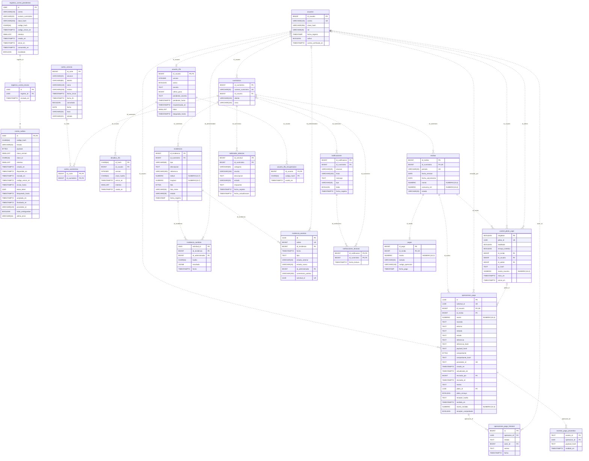
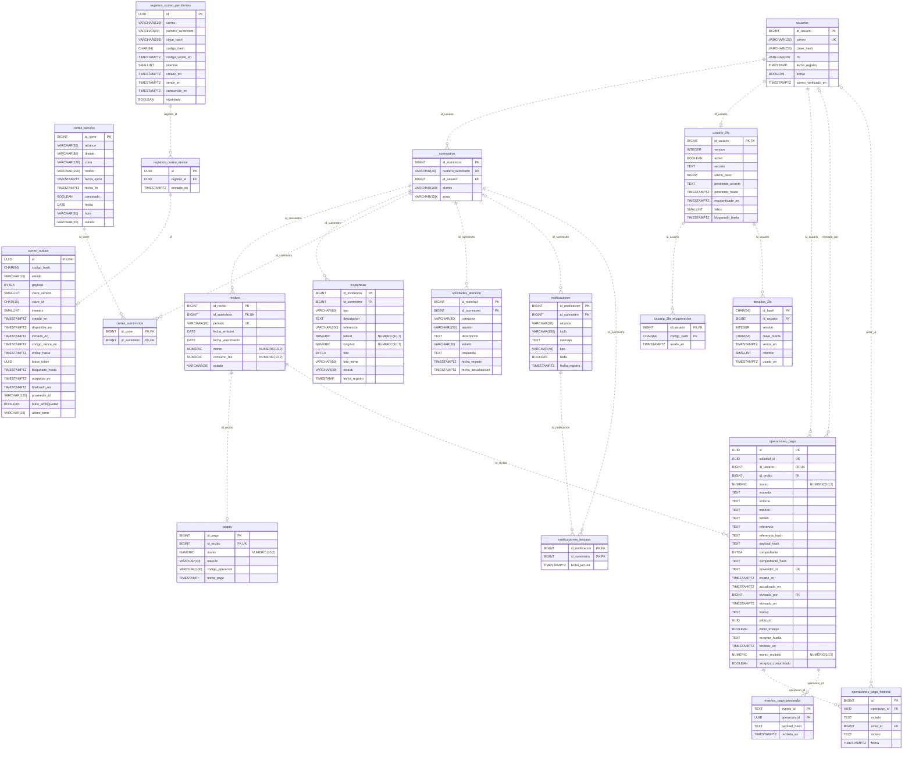

# Diagrama entidad-relación — DD-01

Una arista por FK física, incluidas varias hacia el mismo padre. Padre obligatorio según NOT NULL; máximo de hijos según PK/UNIQUE global, sin convertir índices parciales en unicidad global. Línea discontinua: relación física no identificadora; cardinalidades no implican existencia de hijos. Solo metadatos estáticos.

## laboratorio-init

## laboratorio-ampliado

```mermaid
erDiagram
    control_piloto_yape {
        BOOLEAN singleton PK
        UUID piloto_id UK
        BOOLEAN habilitado
        BOOLEAN ensayo_sintetico
        BIGINT id_recibo FK
        BIGINT id_usuario FK
        BIGINT id_admin FK
        TEXT qr_hash
        NUMERIC monto_maximo "NUMERIC(10,2)"
        TIMESTAMPTZ inicio_en
        TIMESTAMPTZ vence_en
    }
    correo_outbox {
        UUID id PK, FK
        CHAR(64) codigo_hash
        VARCHAR(16) estado
        BYTEA payload
        SMALLINT clave_version
        CHAR(16) clave_id
        SMALLINT intentos
        TIMESTAMPTZ creado_en
        TIMESTAMPTZ disponible_en
        TIMESTAMPTZ iniciado_en
        TIMESTAMPTZ codigo_vence_en
        TIMESTAMPTZ enviar_hasta
        UUID lease_token
        TIMESTAMPTZ bloqueado_hasta
        TIMESTAMPTZ aceptado_en
        TIMESTAMPTZ finalizado_en
        VARCHAR(120) proveedor_id
        BOOLEAN hubo_ambiguedad
        VARCHAR(16) ultimo_error
    }
    cortes_servicio {
        BIGINT id_corte PK
        VARCHAR(20) alcance
        VARCHAR(80) distrito
        VARCHAR(120) zona
        VARCHAR(200) motivo
        TIMESTAMPTZ fecha_inicio
        TIMESTAMPTZ fecha_fin
        BOOLEAN cancelado
        DATE fecha
        VARCHAR(30) hora
        VARCHAR(20) estado
    }
    cortes_suministros {
        BIGINT id_corte PK, FK
        BIGINT id_suministro PK, FK
    }
    desafios_2fa {
        CHAR(64) id_hash PK
        BIGINT id_usuario FK
        INTEGER version
        CHAR(64) clave_huella
        TIMESTAMPTZ vence_en
        SMALLINT intentos
        TIMESTAMPTZ usado_en
    }
    eventos_pago_proveedor {
        TEXT evento_id PK
        UUID operacion_id FK
        TEXT payload_hash
        TIMESTAMPTZ recibido_en
    }
    incidencia_cambios {
        UUID solicitud_id PK
        BIGINT id_incidencia FK
        BIGINT id_administrador FK
        CHAR(64) huella
        JSONB resultado
        TIMESTAMPTZ fecha
    }
    incidencia_eventos {
        UUID id PK
        BIGINT orden UK
        BIGINT id_incidencia FK
        TIMESTAMPTZ fecha
        TEXT tipo
        VARCHAR(20) estado_anterior
        VARCHAR(20) estado_nuevo
        BIGINT id_administrador FK
        VARCHAR(300) comentario_publico
        UUID solicitud_id UK
    }
    incidencias {
        BIGINT id_incidencia PK
        BIGINT id_suministro FK
        VARCHAR(80) tipo
        TEXT descripcion
        VARCHAR(200) referencia
        NUMERIC latitud "NUMERIC(10,7)"
        NUMERIC longitud "NUMERIC(10,7)"
        BYTEA foto
        VARCHAR(50) foto_mime
        VARCHAR(30) estado
        TIMESTAMP fecha_registro
    }
    notificaciones {
        BIGINT id_notificacion PK
        BIGINT id_suministro FK
        VARCHAR(20) alcance
        VARCHAR(150) titulo
        TEXT mensaje
        VARCHAR(40) tipo
        BOOLEAN leida
        TIMESTAMPTZ fecha_registro
        UUID push_evento
        TEXT push_clave
        BIGINT push_recibo FK
        BIGINT push_corte FK
    }
    notificaciones_lecturas {
        BIGINT id_notificacion PK, FK
        BIGINT id_suministro PK, FK
        TIMESTAMPTZ fecha_lectura
    }
    operaciones_pago {
        UUID id PK
        UUID solicitud_id UK
        BIGINT id_usuario FK, UK
        BIGINT id_recibo FK
        NUMERIC monto "NUMERIC(10,2)"
        TEXT moneda
        TEXT entorno
        TEXT metodo
        TEXT estado
        TEXT referencia
        TEXT referencia_hash
        TEXT payload_hash
        BYTEA comprobante
        TEXT comprobante_hash
        TEXT proveedor_id UK
        TIMESTAMPTZ creado_en
        TIMESTAMPTZ actualizado_en
        BIGINT revisado_por FK
        TIMESTAMPTZ revisado_en
        TEXT motivo
        UUID piloto_id FK
        BOOLEAN piloto_ensayo
        TEXT receptor_huella
        TIMESTAMPTZ recibido_en
        NUMERIC monto_recibido "NUMERIC(10,2)"
        BOOLEAN receptor_comprobado
    }
    operaciones_pago_historial {
        BIGINT id PK
        UUID operacion_id FK
        TEXT estado
        BIGINT actor_id FK
        TEXT motivo
        TIMESTAMPTZ fecha
    }
    pagos {
        BIGINT id_pago PK
        BIGINT id_recibo FK, UK
        NUMERIC monto "NUMERIC(10,2)"
        VARCHAR(30) metodo
        VARCHAR(100) codigo_operacion
        TIMESTAMP fecha_pago
    }
    push_dispositivos {
        UUID id PK
        CHAR(64) prueba_hash
        BIGINT id_usuario FK
        BIGINT id_suministro FK
        INTEGER version_seguridad
        INTEGER revision
        CHAR(64) token_hash UK
        BYTEA token_cifrado
        CHAR(16) clave_id
        BOOLEAN activo
        TIMESTAMPTZ consentimiento_en
        BOOLEAN recibos
        BOOLEAN vencimientos
        BOOLEAN incidencias
        BOOLEAN cortes
        TIMESTAMPTZ autorizado_hasta
        TIMESTAMPTZ actualizado_en
    }
    push_entregas {
        UUID id PK
        UUID id_dispositivo FK, UK
        BIGINT id_notificacion FK, UK
        INTEGER revision
        TEXT categoria
        TEXT estado
        SMALLINT intentos
        TIMESTAMPTZ creado_en
        TIMESTAMPTZ disponible_en
        TIMESTAMPTZ vence_en
        UUID lease
        TIMESTAMPTZ bloqueado_hasta
        TIMESTAMPTZ finalizado_en
    }
    recibos {
        BIGINT id_recibo PK
        BIGINT id_suministro FK, UK
        VARCHAR(20) periodo UK
        DATE fecha_emision
        DATE fecha_vencimiento
        NUMERIC monto "NUMERIC(10,2)"
        NUMERIC consumo_m3 "NUMERIC(10,2)"
        VARCHAR(20) estado
    }
    recuperacion_clave_limites {
        CHAR(64) identidad_hash PK
        TIMESTAMPTZ ventana_en
        TIMESTAMPTZ ultimo_envio_en
        SMALLINT solicitudes
        UUID activa_id
    }
    recuperacion_clave_outbox {
        UUID id PK
        UUID solicitud_id FK, UK
        TEXT proposito UK
        TEXT proveedor
        TEXT estado
        BYTEA payload
        CHAR(16) clave_id
        SMALLINT intentos
        TIMESTAMPTZ disponible_en
        UUID lease_token
        TIMESTAMPTZ bloqueado_hasta
        VARCHAR(120) proveedor_id
        TIMESTAMPTZ finalizado_en
    }
    recuperaciones_clave {
        UUID id PK
        CHAR(64) identidad_hash FK
        BIGINT id_usuario FK
        INTEGER version_seguridad
        CHAR(64) clave_huella
        CHAR(64) codigo_hash
        TIMESTAMPTZ creado_en
        TIMESTAMPTZ vence_en
        TIMESTAMPTZ vinculado_en
        SMALLINT intentos
        TIMESTAMPTZ verificado_en
        CHAR(64) permiso_hash
        TIMESTAMPTZ permiso_vence_en
        TIMESTAMPTZ usado_en
        TIMESTAMPTZ invalidado_en
    }
    registros_correo_envios {
        UUID id PK
        UUID registro_id FK
        TIMESTAMPTZ enviado_en
    }
    registros_correo_pendientes {
        UUID id PK
        VARCHAR(120) correo
        VARCHAR(20) numero_suministro
        VARCHAR(255) clave_hash
        CHAR(64) codigo_hash
        TIMESTAMPTZ codigo_vence_en
        SMALLINT intentos
        TIMESTAMPTZ creado_en
        TIMESTAMPTZ vence_en
        TIMESTAMPTZ consumido_en
        BOOLEAN invalidado
    }
    solicitudes_atencion {
        BIGINT id_solicitud PK
        BIGINT id_suministro FK
        VARCHAR(80) categoria
        VARCHAR(150) asunto
        TEXT descripcion
        VARCHAR(20) estado
        TEXT respuesta
        TIMESTAMPTZ fecha_registro
        TIMESTAMPTZ fecha_actualizacion
    }
    suministros {
        BIGINT id_suministro PK
        VARCHAR(20) numero_suministro UK
        BIGINT id_usuario FK
        VARCHAR(100) distrito
        VARCHAR(150) zona
    }
    usuario_2fa {
        BIGINT id_usuario PK, FK
        INTEGER version
        BOOLEAN activo
        TEXT secreto
        BIGINT ultimo_paso
        TEXT pendiente_secreto
        TIMESTAMPTZ pendiente_hasta
        TIMESTAMPTZ reautenticado_en
        SMALLINT fallos
        TIMESTAMPTZ bloqueado_hasta
        TIMESTAMPTZ cambio_seguridad_en
    }
    usuario_2fa_recuperacion {
        BIGINT id_usuario FK, PK
        CHAR(64) codigo_hash PK
        TIMESTAMPTZ usado_en
    }
    usuarios {
        BIGINT id_usuario PK
        VARCHAR(120) correo UK
        VARCHAR(255) clave_hash
        VARCHAR(20) rol
        TIMESTAMP fecha_registro
        BOOLEAN activo
        TIMESTAMPTZ correo_verificado_en
    }
    usuarios ||..o{ suministros : "id_usuario"
    registros_correo_pendientes ||..o{ registros_correo_envios : "registro_id"
    registros_correo_envios ||..o| correo_outbox : "id"
    suministros ||..o{ recibos : "id_suministro"
    recibos ||..o| pagos : "id_recibo"
    suministros ||..o{ incidencias : "id_suministro"
    cortes_servicio ||..o{ cortes_suministros : "id_corte"
    suministros ||..o{ cortes_suministros : "id_suministro"
    suministros ||..o{ solicitudes_atencion : "id_suministro"
    suministros |o..o{ notificaciones : "id_suministro"
    recibos |o..o{ notificaciones : "push_recibo"
    cortes_servicio |o..o{ notificaciones : "push_corte"
    notificaciones ||..o{ notificaciones_lecturas : "id_notificacion"
    suministros ||..o{ notificaciones_lecturas : "id_suministro"
    usuarios ||..o| usuario_2fa : "id_usuario"
    usuario_2fa ||..o{ usuario_2fa_recuperacion : "id_usuario"
    usuario_2fa ||..o{ desafios_2fa : "id_usuario"
    usuarios ||..o{ operaciones_pago : "id_usuario"
    recibos ||..o{ operaciones_pago : "id_recibo"
    usuarios |o..o{ operaciones_pago : "revisado_por"
    control_piloto_yape |o..o{ operaciones_pago : "piloto_id"
    operaciones_pago ||..o{ operaciones_pago_historial : "operacion_id"
    usuarios |o..o{ operaciones_pago_historial : "actor_id"
    operaciones_pago ||..o{ eventos_pago_proveedor : "operacion_id"
    recibos ||..o{ control_piloto_yape : "id_recibo"
    usuarios ||..o{ control_piloto_yape : "id_usuario"
    usuarios ||..o{ control_piloto_yape : "id_admin"
    incidencias ||..o{ incidencia_eventos : "id_incidencia"
    usuarios |o..o{ incidencia_eventos : "id_administrador"
    incidencias ||..o{ incidencia_cambios : "id_incidencia"
    usuarios ||..o{ incidencia_cambios : "id_administrador"
    recuperacion_clave_limites ||..o{ recuperaciones_clave : "identidad_hash"
    usuarios |o..o{ recuperaciones_clave : "id_usuario"
    recuperaciones_clave ||..o{ recuperacion_clave_outbox : "solicitud_id"
    usuarios |o..o{ push_dispositivos : "id_usuario"
    suministros |o..o{ push_dispositivos : "id_suministro"
    push_dispositivos |o..o{ push_entregas : "id_dispositivo"
    notificaciones |o..o{ push_entregas : "id_notificacion"
```

## produccion-minima

## produccion-extendida

```mermaid
erDiagram
    correo_outbox {
        UUID id PK, FK
        CHAR(64) codigo_hash
        VARCHAR(16) estado
        BYTEA payload
        SMALLINT clave_version
        CHAR(16) clave_id
        SMALLINT intentos
        TIMESTAMPTZ creado_en
        TIMESTAMPTZ disponible_en
        TIMESTAMPTZ iniciado_en
        TIMESTAMPTZ codigo_vence_en
        TIMESTAMPTZ enviar_hasta
        UUID lease_token
        TIMESTAMPTZ bloqueado_hasta
        TIMESTAMPTZ aceptado_en
        TIMESTAMPTZ finalizado_en
        VARCHAR(120) proveedor_id
        BOOLEAN hubo_ambiguedad
        VARCHAR(16) ultimo_error
    }
    cortes_servicio {
        BIGINT id_corte PK
        VARCHAR(20) alcance
        VARCHAR(80) distrito
        VARCHAR(120) zona
        VARCHAR(200) motivo
        TIMESTAMPTZ fecha_inicio
        TIMESTAMPTZ fecha_fin
        BOOLEAN cancelado
        DATE fecha
        VARCHAR(30) hora
        VARCHAR(20) estado
    }
    cortes_suministros {
        BIGINT id_corte PK, FK
        BIGINT id_suministro PK, FK
    }
    desafios_2fa {
        CHAR(64) id_hash PK
        BIGINT id_usuario FK
        INTEGER version
        CHAR(64) clave_huella
        TIMESTAMPTZ vence_en
        SMALLINT intentos
        TIMESTAMPTZ usado_en
    }
    eventos_pago_proveedor {
        TEXT evento_id PK
        UUID operacion_id FK
        TEXT payload_hash
        TIMESTAMPTZ recibido_en
    }
    incidencia_cambios {
        UUID solicitud_id PK
        BIGINT id_incidencia FK
        BIGINT id_administrador FK
        CHAR(64) huella
        JSONB resultado
        TIMESTAMPTZ fecha
    }
    incidencia_eventos {
        UUID id PK
        BIGINT orden UK
        BIGINT id_incidencia FK
        TIMESTAMPTZ fecha
        TEXT tipo
        VARCHAR(20) estado_anterior
        VARCHAR(20) estado_nuevo
        BIGINT id_administrador FK
        VARCHAR(300) comentario_publico
        UUID solicitud_id UK
    }
    incidencias {
        BIGINT id_incidencia PK
        BIGINT id_suministro FK
        VARCHAR(80) tipo
        TEXT descripcion
        VARCHAR(200) referencia
        NUMERIC latitud "NUMERIC(10,7)"
        NUMERIC longitud "NUMERIC(10,7)"
        BYTEA foto
        VARCHAR(50) foto_mime
        VARCHAR(30) estado
        TIMESTAMP fecha_registro
    }
    notificaciones {
        BIGINT id_notificacion PK
        BIGINT id_suministro FK
        VARCHAR(20) alcance
        VARCHAR(150) titulo
        TEXT mensaje
        VARCHAR(40) tipo
        BOOLEAN leida
        TIMESTAMPTZ fecha_registro
        UUID push_evento
        TEXT push_clave
        BIGINT push_recibo FK
        BIGINT push_corte FK
    }
    notificaciones_lecturas {
        BIGINT id_notificacion PK, FK
        BIGINT id_suministro PK, FK
        TIMESTAMPTZ fecha_lectura
    }
    operaciones_pago {
        UUID id PK
        UUID solicitud_id UK
        BIGINT id_usuario FK, UK
        BIGINT id_recibo FK
        NUMERIC monto "NUMERIC(10,2)"
        TEXT moneda
        TEXT entorno
        TEXT metodo
        TEXT estado
        TEXT referencia
        TEXT referencia_hash
        TEXT payload_hash
        BYTEA comprobante
        TEXT comprobante_hash
        TEXT proveedor_id UK
        TIMESTAMPTZ creado_en
        TIMESTAMPTZ actualizado_en
        BIGINT revisado_por FK
        TIMESTAMPTZ revisado_en
        TEXT motivo
        UUID piloto_id
        BOOLEAN piloto_ensayo
        TEXT receptor_huella
        TIMESTAMPTZ recibido_en
        NUMERIC monto_recibido "NUMERIC(10,2)"
        BOOLEAN receptor_comprobado
    }
    operaciones_pago_historial {
        BIGINT id PK
        UUID operacion_id FK
        TEXT estado
        BIGINT actor_id FK
        TEXT motivo
        TIMESTAMPTZ fecha
    }
    pagos {
        BIGINT id_pago PK
        BIGINT id_recibo FK, UK
        NUMERIC monto "NUMERIC(10,2)"
        VARCHAR(30) metodo
        VARCHAR(100) codigo_operacion
        TIMESTAMP fecha_pago
    }
    push_dispositivos {
        UUID id PK
        CHAR(64) prueba_hash
        BIGINT id_usuario FK
        BIGINT id_suministro FK
        INTEGER version_seguridad
        INTEGER revision
        CHAR(64) token_hash UK
        BYTEA token_cifrado
        CHAR(16) clave_id
        BOOLEAN activo
        TIMESTAMPTZ consentimiento_en
        BOOLEAN recibos
        BOOLEAN vencimientos
        BOOLEAN incidencias
        BOOLEAN cortes
        TIMESTAMPTZ autorizado_hasta
        TIMESTAMPTZ actualizado_en
    }
    push_entregas {
        UUID id PK
        UUID id_dispositivo FK, UK
        BIGINT id_notificacion FK, UK
        INTEGER revision
        TEXT categoria
        TEXT estado
        SMALLINT intentos
        TIMESTAMPTZ creado_en
        TIMESTAMPTZ disponible_en
        TIMESTAMPTZ vence_en
        UUID lease
        TIMESTAMPTZ bloqueado_hasta
        TIMESTAMPTZ finalizado_en
    }
    recibos {
        BIGINT id_recibo PK
        BIGINT id_suministro FK, UK
        VARCHAR(20) periodo UK
        DATE fecha_emision
        DATE fecha_vencimiento
        NUMERIC monto "NUMERIC(10,2)"
        NUMERIC consumo_m3 "NUMERIC(10,2)"
        VARCHAR(20) estado
    }
    recuperacion_clave_limites {
        CHAR(64) identidad_hash PK
        TIMESTAMPTZ ventana_en
        TIMESTAMPTZ ultimo_envio_en
        SMALLINT solicitudes
        UUID activa_id
    }
    recuperacion_clave_outbox {
        UUID id PK
        UUID solicitud_id FK, UK
        TEXT proposito UK
        TEXT proveedor
        TEXT estado
        BYTEA payload
        CHAR(16) clave_id
        SMALLINT intentos
        TIMESTAMPTZ disponible_en
        UUID lease_token
        TIMESTAMPTZ bloqueado_hasta
        VARCHAR(120) proveedor_id
        TIMESTAMPTZ finalizado_en
    }
    recuperaciones_clave {
        UUID id PK
        CHAR(64) identidad_hash FK
        BIGINT id_usuario FK
        INTEGER version_seguridad
        CHAR(64) clave_huella
        CHAR(64) codigo_hash
        TIMESTAMPTZ creado_en
        TIMESTAMPTZ vence_en
        TIMESTAMPTZ vinculado_en
        SMALLINT intentos
        TIMESTAMPTZ verificado_en
        CHAR(64) permiso_hash
        TIMESTAMPTZ permiso_vence_en
        TIMESTAMPTZ usado_en
        TIMESTAMPTZ invalidado_en
    }
    registros_correo_envios {
        UUID id PK
        UUID registro_id FK
        TIMESTAMPTZ enviado_en
    }
    registros_correo_pendientes {
        UUID id PK
        VARCHAR(120) correo
        VARCHAR(20) numero_suministro
        VARCHAR(255) clave_hash
        CHAR(64) codigo_hash
        TIMESTAMPTZ codigo_vence_en
        SMALLINT intentos
        TIMESTAMPTZ creado_en
        TIMESTAMPTZ vence_en
        TIMESTAMPTZ consumido_en
        BOOLEAN invalidado
    }
    solicitudes_atencion {
        BIGINT id_solicitud PK
        BIGINT id_suministro FK
        VARCHAR(80) categoria
        VARCHAR(150) asunto
        TEXT descripcion
        VARCHAR(20) estado
        TEXT respuesta
        TIMESTAMPTZ fecha_registro
        TIMESTAMPTZ fecha_actualizacion
    }
    suministros {
        BIGINT id_suministro PK
        VARCHAR(20) numero_suministro UK
        BIGINT id_usuario FK
        VARCHAR(100) distrito
        VARCHAR(150) zona
    }
    usuario_2fa {
        BIGINT id_usuario PK, FK
        INTEGER version
        BOOLEAN activo
        TEXT secreto
        BIGINT ultimo_paso
        TEXT pendiente_secreto
        TIMESTAMPTZ pendiente_hasta
        TIMESTAMPTZ reautenticado_en
        SMALLINT fallos
        TIMESTAMPTZ bloqueado_hasta
        TIMESTAMPTZ cambio_seguridad_en
    }
    usuario_2fa_recuperacion {
        BIGINT id_usuario FK, PK
        CHAR(64) codigo_hash PK
        TIMESTAMPTZ usado_en
    }
    usuarios {
        BIGINT id_usuario PK
        VARCHAR(120) correo UK
        VARCHAR(255) clave_hash
        VARCHAR(20) rol
        TIMESTAMP fecha_registro
        BOOLEAN activo
        TIMESTAMPTZ correo_verificado_en
    }
    usuarios ||..o{ suministros : "id_usuario"
    registros_correo_pendientes ||..o{ registros_correo_envios : "registro_id"
    registros_correo_envios ||..o| correo_outbox : "id"
    suministros ||..o{ recibos : "id_suministro"
    recibos ||..o| pagos : "id_recibo"
    suministros ||..o{ incidencias : "id_suministro"
    cortes_servicio ||..o{ cortes_suministros : "id_corte"
    suministros ||..o{ cortes_suministros : "id_suministro"
    suministros ||..o{ solicitudes_atencion : "id_suministro"
    suministros |o..o{ notificaciones : "id_suministro"
    recibos |o..o{ notificaciones : "push_recibo"
    cortes_servicio |o..o{ notificaciones : "push_corte"
    notificaciones ||..o{ notificaciones_lecturas : "id_notificacion"
    suministros ||..o{ notificaciones_lecturas : "id_suministro"
    usuarios ||..o| usuario_2fa : "id_usuario"
    usuario_2fa ||..o{ usuario_2fa_recuperacion : "id_usuario"
    usuario_2fa ||..o{ desafios_2fa : "id_usuario"
    usuarios ||..o{ operaciones_pago : "id_usuario"
    recibos ||..o{ operaciones_pago : "id_recibo"
    usuarios |o..o{ operaciones_pago : "revisado_por"
    operaciones_pago ||..o{ operaciones_pago_historial : "operacion_id"
    usuarios |o..o{ operaciones_pago_historial : "actor_id"
    operaciones_pago ||..o{ eventos_pago_proveedor : "operacion_id"
    recuperacion_clave_limites ||..o{ recuperaciones_clave : "identidad_hash"
    usuarios |o..o{ recuperaciones_clave : "id_usuario"
    recuperaciones_clave ||..o{ recuperacion_clave_outbox : "solicitud_id"
    usuarios |o..o{ push_dispositivos : "id_usuario"
    suministros |o..o{ push_dispositivos : "id_suministro"
    push_dispositivos |o..o{ push_entregas : "id_dispositivo"
    notificaciones |o..o{ push_entregas : "id_notificacion"
    incidencias ||..o{ incidencia_eventos : "id_incidencia"
    usuarios |o..o{ incidencia_eventos : "id_administrador"
    incidencias ||..o{ incidencia_cambios : "id_incidencia"
    usuarios ||..o{ incidencia_cambios : "id_administrador"
```

