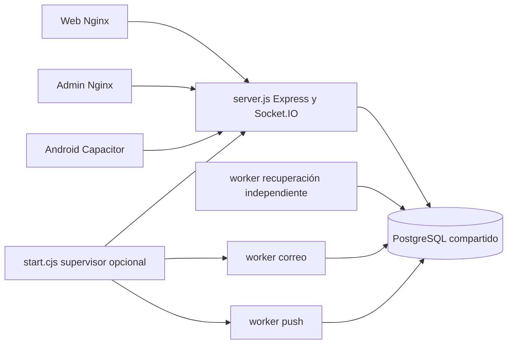

# MS-01 — Auditoría del backend

Fecha: 2026-11-13. Base comprobada mediante `git fetch origin main`:
`1be9c28891272567f63b79f19838800431c09e91`. Árbol inicial limpio; rama
`feature/arquitectura-microservicios-120`. Esta auditoría no acredita una migración
implementada ni el estado de producción. E: lectura de código; P: ejecución;
N: pendiente de comprobar.

## Inventario y método

Se revisaron AGENTS, README, arquitectura, API, base de datos, pruebas,
constitución SDD, especificaciones 001–007, Compose y manifiestos Kubernetes.
Se contrastaron `Backend/server.js`, sus módulos importados, workers,
migraciones 008/011/012/013/014 y consumidores web/Admin. Se enumeró además
`app.router.stack` de Express en Node 22.23.4 con red deshabilitada, sin abrir
puertos ni consultar PostgreSQL: **75 combinaciones método/ruta** (P).
Incluye rutas generadas por bucles: OTP, recuperación, 2FA y operaciones de pago.
HEAD implícitos de Express, preflight CORS y transporte `/socket.io/` se tratan
separadamente. La [matriz](03-matriz-endpoints.md) reemplaza el conteo histórico
de 41 rutas para esta revisión.

Compose tiene cuatro contenedores, pero el dominio HTTP sigue siendo un
monolito. Kubernetes base conserva una API; el overlay mail prepara un worker
con cero réplicas. Ninguno acredita separación de Auth/Billing/Operations.

## Dependencias que condicionan la extracción

| Código | Dependencias y garantía actual | Riesgo de separación directa |
|---|---|---|
| `server.js:539`, `:181` | JWT y consulta de usuarios/suministros/usuario_2fa en cada petición y handshake | Verificar solo firma conservaría permisos revocados durante 8 h |
| `server.js:223` | Sala de revocación antes de releer cuenta y entrar en salas de negocio | Una llamada remota sin coordinación reabre la carrera de revocación |
| `email-registration.js`, `email-outbox.js` | Alta/reenvío/outbox comparten locks advisory por identidad; el worker activa codigo_vence_en | Mover correo fuera de Auth no es solo cambiar el comando del proceso |
| `password-recovery.js`, `two-factor.js` | Cuenta, desafío, permiso, versión MFA y consumo se confirman juntos | Un permiso obsoleto podría reutilizarse si se divide la transacción |
| `receipt-transactions.js` | READ COMMITTED; suministro FOR NO KEY UPDATE, luego recibo FOR UPDATE; nueva lectura de pagos después del lock | Separar recibos y pagos o replicar suministro sin protocolo rompe serialización |
| `payment-operations.js` | Idempotencia, importe desde BD, recibo/operación/historial; bloqueos y errores 409 | Reintentar escrituras en gateway puede duplicar efectos o devolver resultado ambiguo |
| `incident-tracking.js:58` | Revalida administrador y versión con FOR SHARE dentro de la transacción | Introspección HTTP previa sola no conserva esta garantía |
| `incident-tracking.js:115` | Estado, historial por trigger, notificación y deduplicación en el mismo COMMIT | Publicar notificación después por HTTP introduce pérdida y cambia atomicidad |
| `push.js`, `push-worker.js` | Elegibilidad consulta usuarios, suministro, MFA, notificación y dispositivo | Worker separado conserva dependencia SQL entre dominios |
| `server.js:1873`, `:1914`, `:2486` | Listado/detalle de usuarios y resumen cruzan Auth/Billing/Operations | No pueden asignarse a Auth con acceso irrestricto a todas las tablas |

## SQL y efectos indirectos

Los módulos usan parámetros para valores SQL; algunas cláusulas se construyen
con columnas/fragmentos internos. La separación debe conservar sus listas
permitidas. No sustituirlas por SQL enviado a través de HTTP.

Las dependencias no terminan en `pool.query`: 011 cambia versión de seguridad,
invalida desafíos/recuperaciones y cancela outbox al cambiar credenciales;
012 revoca dispositivos al cambiar MFA y encola push desde notificaciones y
cortes; 013 registra/protege historial de incidencias; 008 protege operaciones
e historial. Una prueba de aislamiento debe ejecutar estos triggers bajo los
roles reales de cada servicio. Revocar SELECT de tablas ajenas es insuficiente.

El perfil `init.sql` no equivale a aplicar todas las migraciones: contiene
piloto y omite 011/012/014. 014 rechaza el perfil piloto. Preservar todos los SQL
aplicados y ensayar ampliaciones solo en bases sintéticas nuevas.

## Workers, pagos y documentos

Existen `workers/email-outbox.cjs`, `workers/password-recovery.cjs` y
`workers/push.cjs`. Tienen configuración, opt-in y ciclos propios; el supervisor
puede compartir su destino de fallo con la API. El correo usa leases, límites
temporales y cancelación; Gmail ambiguo no se reenvía automáticamente. No
convertir una entrega ambigua en éxito o reintento ilimitado.

`payment-provider.js` ofrece un simulador inyectable, sin adaptador bancario
comercial ni webhook público. `POST /api/pagos` requiere solicitud_id y no
acredita deuda ficticiamente. `receipt-transactions.pagar()` devuelve 410.
El comprobante HTTP de operación es PNG. Los PDF se generan en el cliente con
jsPDF (`Frontend/index.html:3706` y recursos de documentos); no existe una ruta
de generación PDF en el servidor. Extraer un supuesto servicio PDF sería una
funcionalidad nueva, no preservar la arquitectura.

## Socket.IO

Salas asignadas exclusivamente por servidor: authenticated, admins,
usuario:ID, suministro:ID y auth-revocacion:ID. No existe un handler join
controlado por el cliente. Se comprueban CORS para polling y origen en upgrade.

| Evento | Destino actual |
|---|---|
| incidencia:nueva / incidencia:actualizada | Administradores y suministro propietario |
| atencion:nueva | Administradores y suministro propietario |
| atencion:actualizada | Suministro propietario |
| recibo:nuevo / recibo:actualizado | Suministro propietario |
| pago:nuevo | Administradores |
| pago:registrado | Suministro propietario |
| corte:actualizado | Autenticados |
| perfil:actualizado | Suministro propietario |
| notificacion:nueva | Autenticados si General; suministro si Usuario |
| sesion:invalidada | Cuenta/suministro afectados, seguido de desconexión |

Web (`Frontend/index.html:1398`) y Admin reconsultan REST al recibir eventos;
reconexión no reproduce cada evento perdido. Los emisores capturan errores y
no hay outbox durable general de Socket.IO. MFA también desconecta sockets.
El gateway deberá transportar polling y upgrade sin cambiar path ni auth.token.

## Extracciones y puertas de seguridad

1. Notifications puede comenzar por transporte externo y su estado de entrega;
   Auth debe conservar activación/consumo de OTP. Reutilizar algoritmos de lease
   detrás de contratos explícitos, no compartir credenciales de Auth.
2. Auth debe conservar usuarios, identidad de suministro, MFA, recuperación y
   registro como una unidad. La ubicación de suministro requiere un propietario
   explícito antes de mover Operations.
3. Operations conserva incidencias, historial, cortes y atención. La atomicidad
   de notificaciones exige un contrato transaccional o una decisión explícita
   sobre consistencia eventual, probada antes de sustituir el código.
4. Billing conserva recibos, pagos, operaciones, historial y piloto opcional
   juntos. No extraer recibos y pagos en servicios diferentes.
5. Resúmenes administrativos necesitan composición interna o proyecciones;
   ningún servicio recibirá un usuario PostgreSQL con acceso global por comodidad.

Pendientes críticos: protocolo de revocación concurrente, fronteras SQL de
triggers, permisos negativos y equivalencia de respuestas. La arquitectura
objetivo se describe en [02](02-arquitectura.md); no se han resuelto todavía
mediante implementación y pruebas. No habilitar tráfico nuevo hasta hacerlo.

## Pruebas y evidencia

Inventario vigente comprobado y suite segura: **141 aprobadas, 0 fallidas,
0 omitidas**, Node 22.23.4, SHA anterior, informe local safe-CKGDJl (P).
Dos ensayos anteriores fallaron por Git ausente/propiedad del montaje; el
último usa Git en el contenedor y safe.directory limitado a `/workspace`.
No se modificó ninguna expectativa para hacerlas pasar.

La suite segura cubre configuración, criptografía, proveedores simulados,
sesión, contratos de empaquetado y compatibilidad estática Android. No acredita
SQL, navegador real, APK, procesos nuevos, reinicios ni distribución del gateway.
Ver [06](06-pruebas-validacion.md) para separar resultados de aceptación pendiente.
