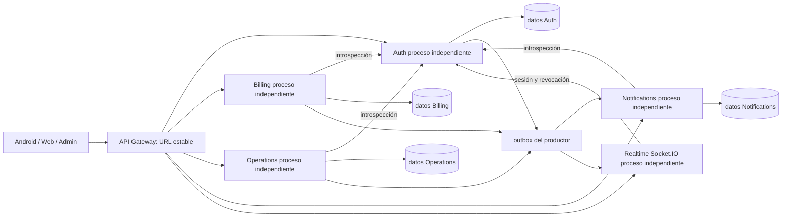

# Arquitectura objetivo y avance de implementación

Avance MS-02: [Notifications transporte](../../Backend/services/notifications/README.md)
implementado y probado en proceso separado. Avance MS-03:
[Auth proceso independiente](../../Backend/services/auth/README.md) con sus 27
rutas de dominio y el contrato interno de introspección. Billing, Operations,
Realtime y el gateway continúan en el backend anterior; el diagrama completo
sigue siendo objetivo pendiente.

Se conserva el monolito como alternativa hasta que todos los criterios MS-01
pasen. Ninguna configuración de producción se cambia por integrar esta documentación.

Los almacenes pueden residir inicialmente en PostgreSQL 18 con roles separados.
Realtime se propone como proceso adicional para que reiniciar entregas de
Notifications no cierre sockets ni detenga Billing. Gateway sin credenciales
SQL; bibliotecas compartidas solo para protocolo, validación y observabilidad.
No importar `server.js` desde cada servicio para filtrar rutas: conservaría
acoplamiento y capacidad de acceso indiscriminado.

| Propietario | Datos propuestos | Contrato para consumidores |
|---|---|---|
| Auth | usuarios, suministros (identidad y ubicación inicialmente), usuario_2fa, usuario_2fa_recuperacion, desafios_2fa, registros_correo_pendientes, registros_correo_envios, correo_outbox, recuperacion_clave_limites, recuperaciones_clave, recuperacion_clave_outbox | Sesión vigente, identidad, ubicación; jobs opacos de entrega |
| Billing | recibos, pagos, operaciones_pago, operaciones_pago_historial, eventos_pago_proveedor, control_piloto_yape opcional | Consultas de actividad y resumen, comandos idempotentes |
| Operations | incidencias, incidencia_eventos, incidencia_cambios, cortes_servicio, asociaciones de cortes y solicitudes_atencion | Consulta autorizada de actividad, eventos de cambios |
| Notifications | notificaciones, notificaciones_lecturas, push_dispositivos, push_entregas | Creación deduplicada, entrega, lectura y revocación |
| Realtime | Cursor/inbox propio; salas en memoria | Eventos mínimos autorizados; reconsulta REST tras reconectar |

Esta propiedad es objetivo, no concesión SQL ejecutada. Las FK y triggers
existentes atraviesan estas fronteras: requieren migración aditiva específica,
contratos estrechos y pruebas de permisos antes de declarar independencia.

## Decisiones

- Recibos y pagos permanecen en Billing para conservar locks y transacciones.
- Los workers de OTP/recuperación conservan la máquina de estado en Auth;
  Notifications ejecutará transporte bajo lease y reportará resultados.
- Outbox PostgreSQL por productor, inbox deduplicada por consumidor y entrega
  al menos una vez. LISTEN/NOTIFY puede acelerar, pero no reemplaza polling ni
  persistencia. No se añade Kafka, RabbitMQ o Redis sin medición que lo justifique.
- Resumen/detalle administrativo: composición de contratos con timeout y
  respuesta de error compatible si falta un dominio; nunca totales cero ficticios.
- Introspección fail-closed por petición conserva estado vigente, pero por sí
  sola no conserva FOR SHARE durante una escritura. Esa carrera necesita un
  protocolo transaccional probado; no se da por resuelta con un token interno.
- Health `/live` comprueba proceso; `/ready` comprueba esquema/permisos y
  dependencias imprescindibles del servicio. Health público conserva contrato.
- Logs JSON: servicio, request_id, operación, duración y código saneado; nunca
  JWT, OTP, contraseña, fotografía, correo o cuerpo completo.

Para sustituir el monolito deben desaparecer lecturas directas de tablas ajenas
y escrituras fuera de contratos. Compartir instancia PostgreSQL es aceptable;
compartir un rol omnipotente o exponer SQL genérico no lo es.
