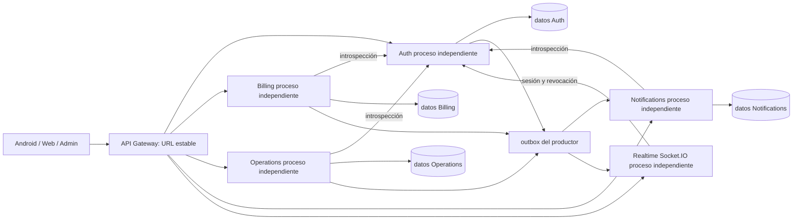

# Arquitectura objetivo y avance de implementación

MS-05 añade Billing, Operations, Realtime y Gateway como procesos separados.
Auth conserva cuentas y sesión. Notifications atiende la bandeja, push y
transporte de correo. El [laboratorio MS-05](10-laboratorio-servicios.md)
sirve las 75 rutas públicas y Socket.IO a través de Gateway. El modo anterior
sigue disponible para las instalaciones existentes y para reversión.

La implementación usa una instancia PostgreSQL 18 con roles separados,
proyecciones de lectura y funciones acotadas. Realtime consume eventos de
PostgreSQL. Gateway no tiene rol SQL. La separación permite reiniciar cada
dominio sin ejecutar `server.js` para atender sus rutas.

| Propietario | Datos propuestos | Contrato para consumidores |
|---|---|---|
| Auth | usuarios, suministros (identidad y ubicación inicialmente), usuario_2fa, usuario_2fa_recuperacion, desafios_2fa, registros_correo_pendientes, registros_correo_envios, correo_outbox, recuperacion_clave_limites, recuperaciones_clave, recuperacion_clave_outbox | Sesión vigente, identidad, ubicación; jobs opacos de entrega |
| Billing | recibos, pagos, operaciones_pago, operaciones_pago_historial, eventos_pago_proveedor, control_piloto_yape opcional | Consultas de actividad y resumen, comandos idempotentes |
| Operations | incidencias, incidencia_eventos, incidencia_cambios, cortes_servicio, asociaciones de cortes y solicitudes_atencion | Consulta autorizada de actividad, eventos de cambios |
| Notifications | notificaciones, notificaciones_lecturas, push_dispositivos, push_entregas | Creación deduplicada, entrega, lectura y revocación |
| Realtime | Cursor/inbox propio; salas en memoria | Eventos mínimos autorizados; reconsulta REST tras reconectar |

La migración 015 aprovisiona las concesiones sobre roles ya creados. Las FK
entre dominios se conservan en la instancia. Los permisos y el procedimiento
se detallan en el [laboratorio MS-05](10-laboratorio-servicios.md).

## Decisiones

- Recibos y pagos permanecen en Billing para conservar locks y transacciones.
- Los workers de OTP/recuperación conservan la máquina de estado en Auth;
  Notifications ejecutará transporte bajo lease y reportará resultados.
- Outbox PostgreSQL por productor, inbox deduplicada por consumidor y entrega
  al menos una vez. LISTEN/NOTIFY puede acelerar, pero no reemplaza polling ni
  persistencia. No se añade Kafka, RabbitMQ o Redis sin medición que lo justifique.
- Resumen/detalle administrativo: composición de contratos con timeout y
  respuesta de error compatible si falta un dominio; nunca totales cero ficticios.
- Introspección fail-closed por petición conserva estado vigente, pero por sí
  sola no conserva FOR SHARE durante una escritura. Esa carrera necesita un
  protocolo transaccional probado; no se da por resuelta con un token interno.
- Health `/live` comprueba proceso; `/ready` comprueba esquema/permisos y
  dependencias imprescindibles del servicio. Health público conserva contrato.
- Logs JSON: servicio, request_id, operación, duración y código saneado; nunca
  JWT, OTP, contraseña, fotografía, correo o cuerpo completo.

Para sustituir el monolito deben desaparecer lecturas directas de tablas ajenas
y escrituras fuera de contratos. Compartir instancia PostgreSQL es aceptable;
compartir un rol omnipotente o exponer SQL genérico no lo es.
