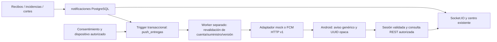

# Push Android — laboratorio Hidro-Mejora 1.2.0

Base `6a83dc51b44fb5c1a98cdb3c3efe0352573d1b79` (`feature/recuperacion-clave-120`). Nueva rama `feature/notificaciones-push-120`, dependiente de los PR anteriores. No publicar 1.2.0 ni activar entregas reales.

## Arquitectura y fuente de verdad



La migración aditiva **012_notificaciones_push.sql** requiere 011 y se aplicó solo en PostgreSQL 18 nuevo. Agrega `push_dispositivos`, `push_entregas` y metadatos opcionales de evento en notificaciones. La inserción del centro y sus entregas es atómica mediante trigger. No cambia `notificaciones_lecturas`, recibos, pagos, fotografías ni el historial anterior; no encola avisos históricos al aplicar 012.

La creación de recibos ya notifica después de su COMMIT mediante el helper existente. Se conserva ese diseño: un fallo entre el COMMIT del recibo y su notificación puede omitir el aviso; no se afirma atomicidad conjunta del recibo y el centro. Revisar reconciliación/atomicidad de ese origen antes de una garantía más fuerte de publicación.

Eventos: recibo nuevo; incidencia cuyo estado cambió; corte General; Zona exacta de distrito/zona; asociación legacy por suministro. El endpoint de incidencia ahora devuelve el estado actual sin crear otro aviso ante una repetición idéntica. No se crean eventos push de pagos.

**Hallazgo de alcance:** el esquema/API vigentes solo admiten `General` y `Zona`; `cortes_suministros` conserva asociaciones legacy. No existe un alta independiente de corte `Distrito` o `Suministro`. Este avance no elimina restricciones para inventarlos: utiliza Zona y asociaciones autorizadas, y nunca convierte un aviso localizado en General. Un alcance Distrito independiente requiere un cambio funcional posterior del modelo/API y sus pruebas; no está aprobado como escenario real.

## Seguridad

- API de dispositivos solo con JWT completo de usuario, guard actual y revalidación dentro de transacción. No acepta desafíos 2FA ni rol Admin. Asociación a usuario, suministro, versión de seguridad y fecha de caducidad del JWT; máximo ocho horas y diez dispositivos activos por cuenta. No extiende sesiones.
- UUID de instalación + secreto aleatorio de 256 bits; el backend guarda solo hash de la capacidad de revocación. No permite tomar otra instalación cambiando el usuario autenticado sin demostrar esa capacidad. Tokens duplicados entre instalaciones no se reasignan a ciegas.
- Token FCM cifrado AES-256-GCM, AAD con instalación/revisión y HMAC para unicidad, clave exclusiva `PUSH_TOKEN_KEY`. Nunca se devuelve el token ni la prueba en respuestas del backend/logs. El token solo cruza TLS hacia API/FCM; el SDK Firebase mantiene su estado privado nativo.
- El consentimiento local también se vincula al par usuario/suministro de la sesión ya validada. Otro usuario, incluso con un suministro reasignado, no hereda activación ni preferencias: se revoca la asociación anterior y debe activar de nuevo. Decodificar identificadores del JWT aquí solo distingue el contexto local; nunca sustituye verificación/autorización REST. No se guarda ese JWT en el slot push.

- El slot nativo `push` es independiente de `session` y `registration`, con clave/AAD separados y sin backup. Guarda capacidad/consentimiento/preferencias y revocación pendiente; no copia el JWT ni el token FCM a Web Storage. Se conserva el cifrado Keystore anterior.
- Logout/desactivar: marcar revocación pendiente cifrada antes de retirar asociación remota; invocar unregister y retirar avisos de la bandeja cuando Firebase esté configurado. La capacidad pública solo revoca, no lee ni inicia sesión. Puede sincronizarse tras retirar JWT, incluso si la función fue desactivada en el servidor.
- Sin conexión no es posible garantizar revocación instantánea en el servidor. Se conserva la revocación pendiente, se desactiva localmente, se intenta borrar token SDK y se vacía antes de volver a activar/cambiar de cuenta. Un mensaje ya en vuelo podría llegar; solo contiene texto genérico y UUID, y nunca abre datos de otra cuenta. Autorización remota expira como máximo con el JWT de ocho horas.
- Cambio de contraseña/2FA/rol/estado invalida la asociación mediante versión y trigger. El worker revalida cuenta, suministro actual, consentimiento, preferencias, revisión, autorización y TTL inmediatamente antes de enviar. No es posible retirar un envío ya aceptado por FCM; su contenido es deliberadamente no sensible.
- Payload de lista cerrada: texto genérico + `hm_event` UUID; sin importes, suministro, correo, direcciones, OTP, JWT, claves 2FA ni datos bancarios. Sin temas públicos. El toque resuelve la UUID en `/api/push/events/:id`, valida suministro/rol y devuelve solo una sección permitida. Datos FCM, rutas y URLs arbitrarias no abren información privada.

## Cola, vencimientos y retención

Una fila por notificación/dispositivo, revisión de token y consentimiento. Rotación, cambio de preferencias o de cuenta cancela las entregas anteriores. Tres intentos como máximo, backoff con jitter y Retry-After; token no registrado retira la asociación. Un timeout/respuesta incierta o lease abandonado termina `ambiguo`, sin reenvío automático. FCM no aporta idempotencia exactamente una vez: se reduce duplicación con UUID, tag Android y deduplicación/coalescencia del cliente; no se promete entrega exactamente una vez.

Estados: pendiente/procesando/reintento/aceptado/cancelado/fallido/ambiguo/caducado; **simulado** identifica el mock. Aceptación de FCM no equivale a recepción, apertura ni lectura. TTL de cola una hora. Al expirar autorización se retira ciphertext/hash del token; después de 30 días se desvinculan metadatos terminales push de usuario/suministro/notificación, sin borrar el centro ni sus lecturas/historial.

`--reminders` exige `PUSH_REMINDERS_ENABLED=1`. Usa fechas registradas, ventana de tres días y zona horaria America/Lima; excluye recibos Pagado/Anulado y aquellos con pago registrado. Clave única por recibo/fecha evita repeticiones y el worker vuelve a verificar estado/fecha antes de enviar. No crea fechas ni considera una operación sintética como pago bancario.

## Configuración cerrada

Por defecto `PUSH_ENABLED=0`, `PUSH_WORKER_ENABLED=0`, `PUSH_REMINDERS_ENABLED=0`, `PUSH_REAL_DELIVERY_ALLOWED=0`. No se agrega el worker al supervisor de producción ni se ejecutan migraciones al arrancar.

Worker `Backend/workers/push.cjs --once|--run|--reminders`, destino explícito `PUSH_DATABASE_URL` y nombre `PUSH_EXPECTED_DATABASE`. Mock solo permite NODE_ENV=test y base de loopback. FCM requiere además autorización explícita, proyecto y cuenta de servicio privada externa al repositorio, propietario actual y permisos 600. El adaptador firma OAuth con scope `firebase.messaging`, token de acceso en memoria, endpoints HTTPS fijos, timeouts y rechazo de redirecciones. Ninguna credencial real se creó ni cargó en este avance.

Android: plugin oficial `@capacitor/push-notifications` 7.0.7, auto-init FCM desactivado, POST_NOTIFICATIONS voluntario, canal `hm_updates`, icono monocromo de la gota original. Sin google-services.json compila y muestra configuración pendiente. Además requiere `HM_PUSH_ANDROID_ENABLED=1` al compilar; no basta que exista por accidente un archivo local. No solicita permiso en login; el control está en Cuenta. Guía posterior: `docs/android-push-firebase.md`.

## Validación incremental

Primer incremento backend: **14/14** pruebas Node 22/PostgreSQL 18 aislado: migración con datos/fotografías/lecturas/secuencias y dependencia 011; configuración cerrada; roles/consentimiento; cifrado; varios dispositivos/rotación; capacidad de revocación/cambio de cuenta; JWT/2FA/deshabilitación; preferencias y UUID duplicada; vencimientos; cortes; concurrencia/reintentos/token inválido/ambigüedad; retención; endpoints existentes; HTTP v1 y OAuth completamente simulados, scope mínimo y caché, permisos de archivos.

Regresión amplia inicial: 123 aprobadas, cero fallidas y una variante de esquema histórico omitida por configuración. Incluye OTP, 2FA, recuperación de contraseña, sesiones, recibos/pagos, PDF e HidroBot. La variante legacy de recibos se ejecutó aparte: 12 aprobadas, una alternativa inversa omitida. Ambos escenarios de esquema están cubiertos entre las ejecuciones, sin borrar datos.

## Interfaz y validación Android

`Frontend/assets/js/push-notifications.js` integra la tarjeta de Cuenta con los flujos existentes. No reescribe las demás pantallas. El cliente web muestra incompatibilidad conservando su centro; no hay fallback de tokens a localStorage. La suscripción usa el método **fetch autenticado** de createHMClientSession; authFetch es público y no se utiliza para registrar dispositivos ni resolver avisos. Se validó esta distinción con la WebView real, que detectó el 401 que no aparecía en el adaptador web inicial.

El bridge global nativo puede devolver un handle de listener síncrono, mientras el paquete JavaScript moderno devuelve una promesa. La suscripción appStateChange admite ambos y nunca bloquea el login. En reanudación consulta permiso/estado y evita repetir registro si ya dispone del token; online reintenta autorizaciones pendientes sin ampliar la sesión. Los toques esperan el fin de una navegación actual y se procesan después de restaurar datos autenticados. Una notificación no inventa datos ni sustituye esa validación.

Pruebas Chromium con API/PostgreSQL y Socket.IO reales, callbacks/proveedor push **simulados**: rechazo/concesión sin prompt al login; alta cifrada; evento de primer plano, deduplicación y consulta de centro; toque abre Recibos; payload con URL ignorado; revocación offline conserva estado y reconexión lo retira; cambio de identidad exige nuevo consentimiento sin re-registro automático; preferencias sin desbordamiento en 360×800, 390×844, 768×1024, 1366×768 y 1920×1080. La fixture inyecta exclusivamente transporte y estado Android simulado; no prueba registro nativo ni entrega remota FCM.

Suite final de backend push/configuración/UI/transición: 45/45 aprobadas (final-all.log), incluidas 15 de backend/esquema. Una prueba reproduce revocación entre claim y envío: el proveedor no llega a invocarse. Revisión final de interfaz/transición 19/19 (ui-closed.log). No sumar con la suite amplia como pruebas únicas: varios casos se repiten. Algunas primeras ejecuciones fallaron por un selector ambiguo de título y por navegación aún en transición; se acotaron al centro visible y se esperó la navegación real antes de seguir. El tutorial inicial podía aparecer después de consultar Cuenta; la fixture ahora espera su apertura y lo cierra con su botón real antes de iniciar el caso push. No se desactivó el tutorial ni ningún control de producción.

Android 15/API 35, AVD independiente `hm_110_debug_api35`:

1. Keystore instrumentado: clave no exportable, AES-GCM, IV variable, alteración rechazada y borrado.
2. Instrumentación del slot push: cifrado e independencia de sesión/registro, sin cambiar alias ni claves previas.
3. Login/Keystore existentes funcionan sin google-services.json; no hay registro ni prompt automático.
4. Permiso POST_NOTIFICATIONS denegado mediante el diálogo Android real; el bridge devuelve también prompt-with-rationale, tratado como no concedido.
5. Permiso concedido voluntariamente y canal nativo creado/listado; nunca se llamó al registro real FCM sin configuración.
6. Centro real con aviso de laboratorio consultado desde PostgreSQL y estado de lectura separado.
7. Intent local de toque con sesión válida resuelve UUID y abre Recibos.
8. Intent local con proceso cerrado restaura la sesión y después navega.
9. Capacidad del dispositivo cifrada en archivo nativo; no aparece en claro.
10. Después del logout, un intent local no permite abrir datos y permanece en login.

Intents con extras del plugin se inyectan mediante adb para probar navegación; **no equivalen a una notificación recibida desde FCM**, ni prueban la bandeja remota o el despertar del proceso por Firebase. La recepción de primer plano está simulada en Chromium. No están aprobadas la recepción remota en segundo plano ni con proceso cerrado.

Gradle Java 21: assembleDebug, assembleDebugAndroidTest, testDebugUnitTest y lintDebug satisfactorios. Cuatro JUnit (tres DocumentPayload y uno existente), dos casos instrumentados distintos. Lint: cero errores y 16 advertencias de recursos/manifest/iconos. Normal build sin configuración Firebase comprobado. Npm audit runtime de la raíz: cero vulnerabilidades reportadas en esta ejecución; no sustituye una auditoría del ecosistema completo.

Se conservan los intentos fallidos en artifacts: un 401 por wrapper público fue corregido con el cliente autenticado, una suposición de estado denied ignoraba prompt-with-rationale y el handle síncrono del bridge requería Promise.resolve. No se redujeron controles para aprobar los tests.

Evidencia: `artifacts/notificaciones-push-120/web/` (preferencias, centro y cinco resoluciones), backend-verified.log, regression.log, legacy.log, final-all.log, ui-closed.log, backend-race-final.log y logs nativos. Última ejecución Android aprobada: `artifacts/android-session-native-wrG8tm/`, con log `artifacts/notificaciones-push-120/native-final-all.log`. Contiene result.json, capturas adb, build.log, JUnit/lint e instrumentation.txt y push-instrumentation.txt. No se publican estos archivos privados.

## Archivos y conservación

Backend: push.js, push-worker.js, push-provider.js, workers/push.cjs, rutas en server.js, fixtures y tests. SQL: 012_notificaciones_push.sql. Cliente: tarjeta de Cuenta en index.html, módulo push-notifications.js y CSS acotado. Android: dependencia oficial, manifest/canal/icono, flag de compilación, plugin HidroPushState y nuevo slot cifrado, dos archivos de enlace Capacitor generados, instrumentación y harness. Configuración/docs: .gitignore, ambos vercel.json, .env.example, scripts npm, runtime guard, roadmap e informe/guía.

No se modificaron contratos OTP/2FA/recuperación ni PDF, pagos, gráficos o HidroBot. APK 1.1.1 SHA-256 `541b4c9d70a52396266358d786032db47c85e99aa2ae4d7ae1bcf5eb28c3bb4b` y 1.1.2 `a6b81541a210e79ffb6ec8a38c79b8b1260758ab45c246b81fca45ee4439ed93` confirmadas sin cambios. Solo debug local del AVD; sin release ni versión nueva.

Evidencia local ignorada: `artifacts/notificaciones-push-120/`. No versionar tokens, claves, JSON Firebase, logs privados ni APK.

## Laboratorio reproducible, sin cuentas reales

```sh
lab_name="hm-push-lab-$(date +%s)"
docker run -d --name "$lab_name" --label hidro.task=notificaciones-push-120 \
 -e POSTGRES_USER=hm_fixture -e POSTGRES_PASSWORD=fixture-only-not-production \
 -e POSTGRES_DB=hm_email_test -p 127.0.0.1::5432 postgres:18
export HIDRO_EMAIL_TEST_DB_PORT="$(docker port "$lab_name" 5432/tcp | awk -F: '{print $NF}')"
docker exec "$lab_name" pg_isready -U hm_fixture -d hm_email_test
# Esperar readiness. Cada suite crea su propia base; no lee .env productivos.
artifacts/pagos-pdf-120/tools/node --test Backend/test/push.cjs Backend/test/push-schema.cjs
export PLAYWRIGHT_BROWSERS_PATH="$PWD/artifacts/vercel-validation/browsers"
artifacts/pagos-pdf-120/tools/node --test scripts/test/push-flow.cjs
artifacts/pagos-pdf-120/tools/node scripts/test/android-session-native.cjs --push
# Detener solo el contenedor recién creado; conservar sus datos/volúmenes.
docker stop "$lab_name"
```

## Pendientes para activación real

Proyecto Firebase expresamente autorizado, configuración Android privada y credencial servidor mínima; revisión de cola, respaldo/migración autorizados y prueba controlada real. Android físico, recepción FCM en primer/segundo plano y proceso cerrado, rotación nativa en segundo plano, Doze/espacio privado y variantes Android 13/14. Solo API 35 disponible aquí. Los intents locales y callbacks simulados no aprueban esos escenarios.

Revisar operación, métricas sin tokens, renovación/rotación de claves y retención de copias de respaldo. No rollback a un backend que ignore versión de sesiones. Aceptar la limitación offline y la ventana de mensajes ya en vuelo antes de activar fuera del laboratorio. Sin cambios productivos ni gastos.


## GitHub y cierre

Draft PR #17: https://github.com/NicolasAG-pe/Sedapal/pull/17, base `feature/recuperacion-clave-120`. Primer incremento backend `dd7de2f0e7ad3695f2a870b2cf43449cdc5cc54e`, push y SHA remoto confirmados. Segundo incremento con UI/Android y pruebas finales. Árbol revisado para excluir tokens, claves, configuración Firebase, APK y evidencias privadas; los dos vercel.json excluyen esta rama. GitHub sin workflows/hooks activos; Render permanece en main, autodespliegue/previews apagados, consultado solo en lectura. No se crearon despliegues Vercel para esta rama tras el push.

No se crearon proyectos Firebase ni se enviaron notificaciones o correos reales. Se conserva la base de laboratorio al detener su contenedor, sin eliminar contenedores ni volúmenes. Las 14 referencias remotas anteriores se comparan al cerrar; no se hace merge ni se altera ninguna rama anterior. Presupuesto S/ 0.
